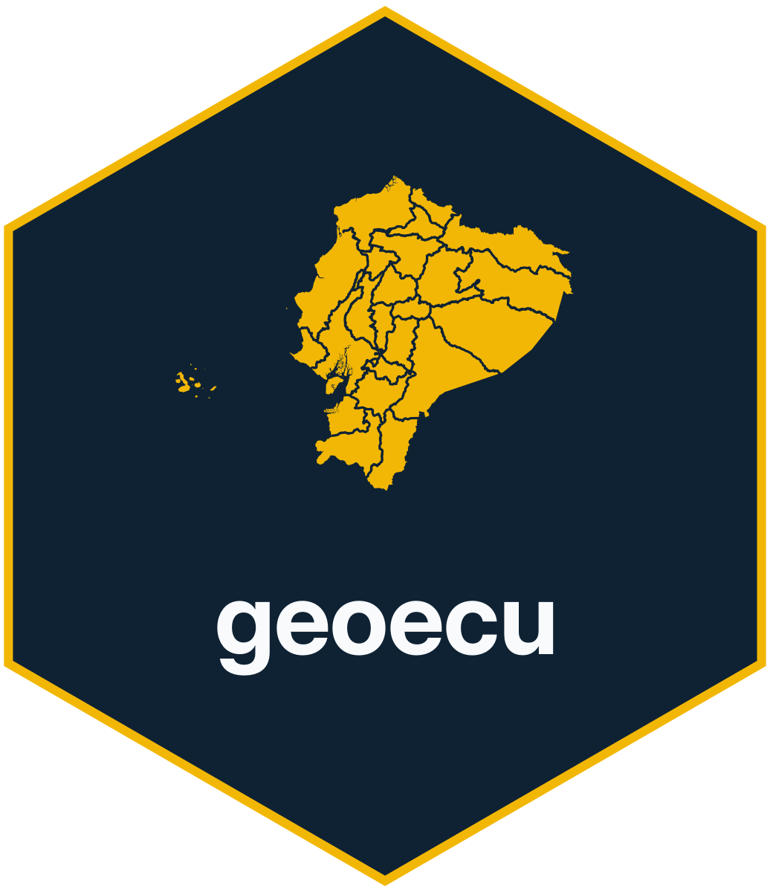
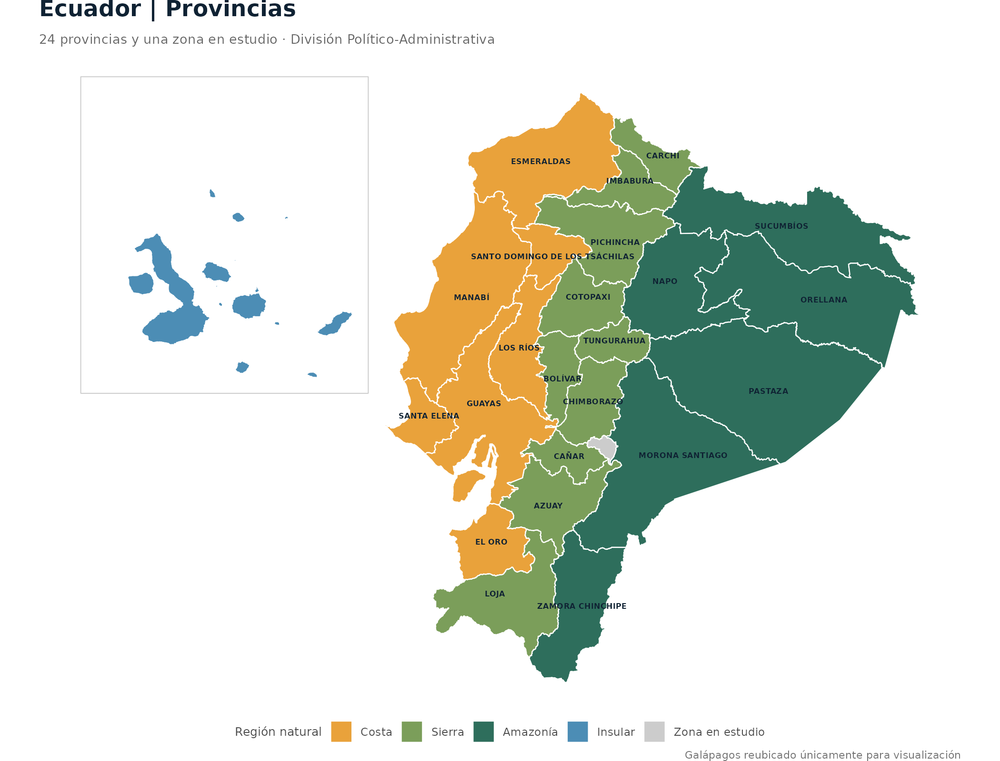
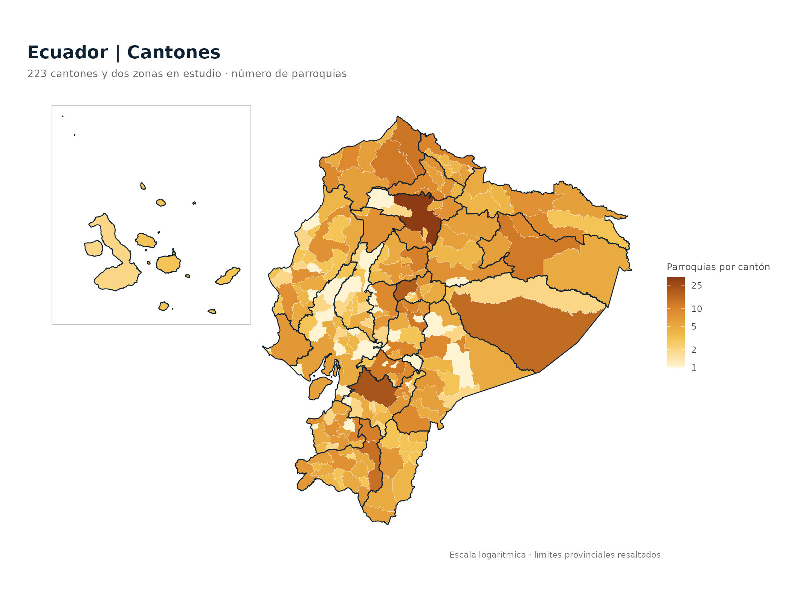
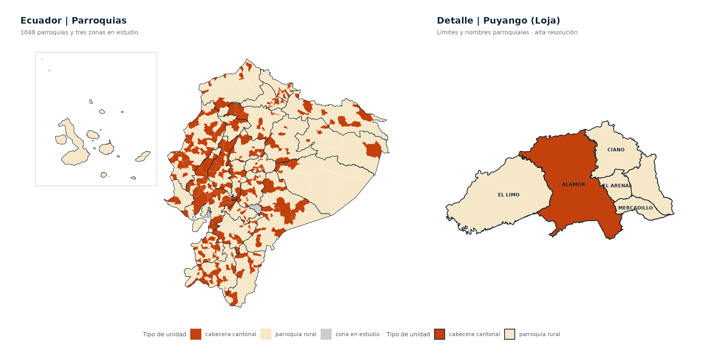
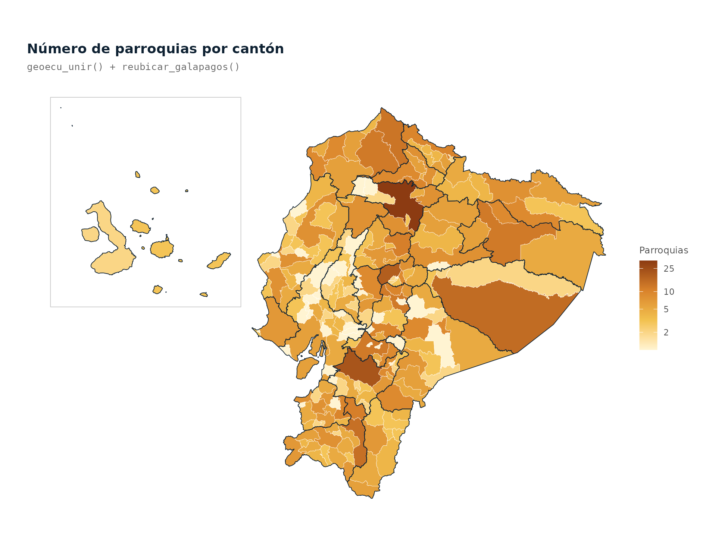
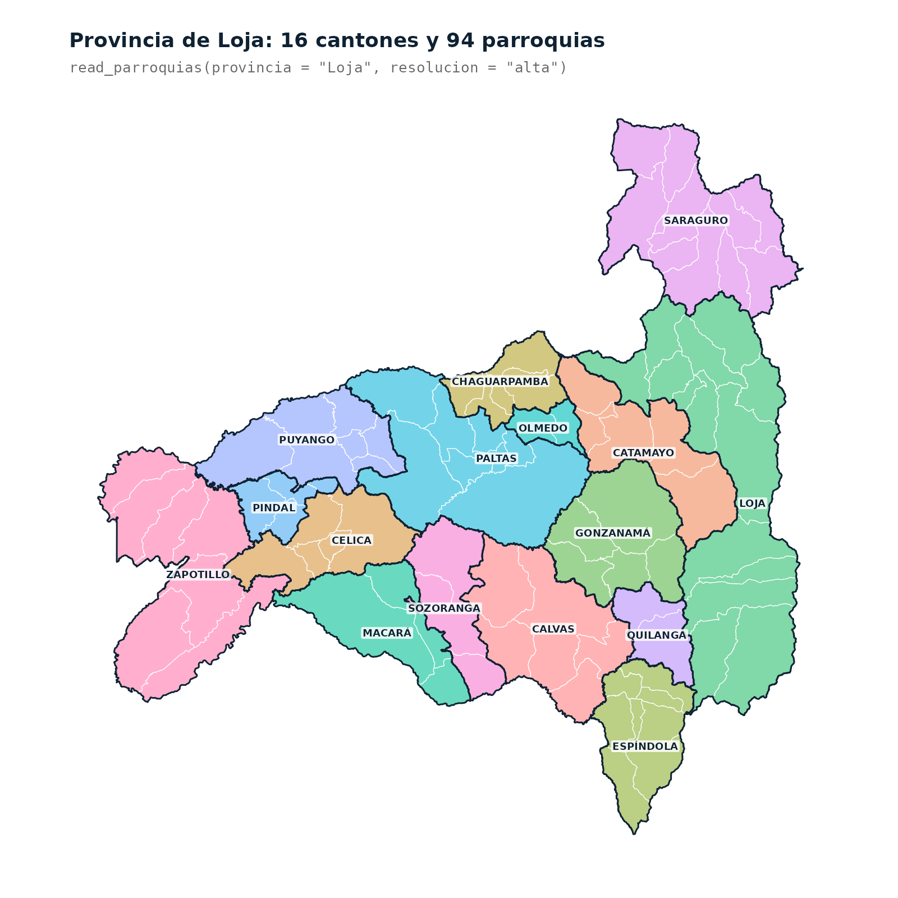
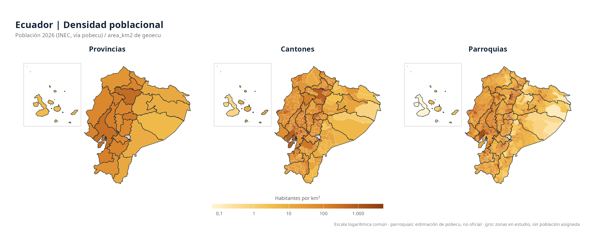

# geoecu 

**Official boundaries of Ecuador's provinces, cantons and parishes as `sf` objects.**

[Español](README.md) · **English**

<!-- badges: start -->
[](https://cran.r-project.org/package=geoecu)
[](https://doi.org/10.32614/CRAN.package.geoecu)
[](https://cran.r-project.org/package=geoecu)
[](https://github.com/f-slg/geoecu/actions/workflows/R-CMD-check.yaml)
[](https://f-slg.github.io/geoecu/)
[](https://github.com/f-slg/geoecu/blob/main/LICENSE.md)
[](https://github.com/f-slg/geoecu/blob/main/inst/COPYRIGHTS)
<!-- badges: end -->

> **About the language.** This is a translation of the Spanish README. The
> package is aimed at users in Ecuador and Latin America: function names,
> arguments, column names, messages, the reference documentation and the
> vignettes are in Spanish. See the [glossary](#glossary) below.

**geoecu** gives one-line access to the boundaries of **Ecuador's provinces,
cantons and parishes**, identified by the codes of the national
**Political-Administrative Division (DPA, *División Político-Administrativa*)**,
ready to be mapped and joined with health, epidemiological surveillance or any
other data. The layers come from the
[open data of the Territorial Organization of the State](https://www.datosabiertos.gob.ec/dataset/organizacion-territorial-parroquial)
published by CONALI (National Committee of Internal Boundaries, Ministry of
Government).

> **Note:** geoecu is an independent package developed in a personal
> capacity. It is not an official product of any institution, including
> CONALI or the Ministry of Government.

## Installation

Run this in the **R or RStudio console**. The plotting packages are optional
for reading layers but needed to reproduce the figures on this page.

```r
install.packages(c("geoecu", "ggplot2", "patchwork", "scales"))
library(geoecu)
library(ggplot2)
```

**Development version (GitHub):**

```r
install.packages("remotes")
remotes::install_github("f-slg/geoecu")
```

On first use, the geometries are downloaded from the
[data release](https://github.com/f-slg/geoecu/releases/tag/datos-v0.3.0),
verified and cached for future sessions.

<details>
<summary><strong>Ubuntu / Debian: sf system requirements</strong></summary>

`geoecu` depends on `sf`. To avoid compiling geospatial libraries on Ubuntu,
install the binary from the **shell** before installing the R package:

```bash
sudo apt update
sudo apt install r-cran-sf
```

If you build `sf` from source, the system dependencies include `libgdal-dev`,
`libgeos-dev`, `libproj-dev`, `libudunits2-dev` and `libssl-dev`.

</details>

## First map

```r
library(geoecu)
library(ggplot2)

provincias <- read_provincias()
ggplot(provincias) +
  geom_sf(fill = "#DCEAF2", color = "#0F2233", linewidth = 0.25) +
  labs(title = "Provinces of Ecuador") +
  theme_void()
```

## Features

- **Up-to-date data**: 24 provinces, 223 cantons and 1,048 parishes according
  to the Territorial Organization of the State of 17 July 2026 (including the
  new canton of Borbón and the parish of Miss Ecuador).
- The three levels **nest exactly**: each canton is the union of its parishes
  and each province the union of its cantons, with no gaps or overlaps.
- Two resolutions: `"baja"` (low, 3 MB, for maps, bulletins and Shiny
  dashboards) and `"alta"` (high, 39 MB, for spatial analysis).
- Filters by **name or code**, ignoring accents and case, with suggestions when
  a name does not exist or is ambiguous.
- Joins your tables by DPA code even when the codes come from Excel without
  leading zeros.
- National maps with **Galápagos relocated** next to the mainland.
- Converts codes from earlier DPA versions (urban parishes, the former Eloy
  Alfaro canton) with `actualizar_codigo()`.
- One-time download, verified and cached; works offline afterwards.

📖 **Documentation (Spanish):** [User guide](https://f-slg.github.io/geoecu/articles/guia.html) · [Full gallery](https://f-slg.github.io/geoecu/articles/galeria.html) · [Data source](https://f-slg.github.io/geoecu/articles/datos.html) · [Functions](https://f-slg.github.io/geoecu/reference/)

## Queries and joining your own data

### Read by province, canton and type

```r
library(geoecu)

read_cantones(provincia = "Loja")
read_parroquias(canton = "Puyango", tipo = "rural")
read_parroquias(provincia = "Loja", resolucion = "alta")

# Projected CRS for spatial analysis in Loja
read_cantones(provincia = "Loja", crs = 32717)
```

Each layer is an `sf` object with DPA codes and the area `area_km2`:

| Layer | Main columns |
|---|---|
| `read_provincias()` | `dpa_provin`, `provincia`, `tipo`, `area_km2` |
| `read_cantones()` | `dpa_canton`, `canton`, `dpa_provin`, `provincia`, `area_km2` |
| `read_parroquias()` | `dpa_parroq`, `parroquia`, `tipo`, `dpa_canton`, `canton`, `area_km2` |

`area_km2` is the area in km², computed on the WGS84 ellipsoid from the
high-resolution layer.

### Join a table by DPA code

This example uses **made-up demonstration data**. Replace `datos_demo` with
your own table before interpreting any result.

```r
library(geoecu)
library(ggplot2)

# Made-up data, only to test the join (NOT real cases)
datos_demo <- data.frame(
  cod_canton = c("1101", "1102", "1110"),
  eventos_demo = c(12, 4, 7)
)

mapa_demo <- geoecu_unir(
  datos_demo, codigo = "cod_canton", nivel = "canton",
  provincia = "Loja"
)

ggplot(mapa_demo) +
  geom_sf(aes(fill = eventos_demo), color = "white", linewidth = 0.2) +
  scale_fill_gradient(low = "#DCEAF2", high = "#12618A",
                      na.value = "grey90", name = "Example") +
  labs(title = "DPA join demo: Loja",
       subtitle = "Made-up data; not observed events") +
  theme_void()
```

Cantons without data get `NA`. Before making epidemiological maps, aggregate
events to the same territorial level and check the code matching.

### DPA catalogue, search and cleaning

```r
head(dpa)
buscar_dpa("arenal")
buscar_dpa("puyango", nivel = "canton")
formatear_codigo(c(701, 1101), "canton")
normalizar_nombre("Cañar ")
```

### Codes from earlier versions

Since version 0.4.0, urban parishes are part of their **cantonal seat**
(*cabecera cantonal*). To update codes from earlier versions and review the
equivalences:

```r
actualizar_codigo(c("010101", "080253"))
subset(dpa_equivalencias, cambio == "código distinto")
```

### Offline use

```r
# Where the downloaded layers are stored
geoecu_cache_dir()
geoecu_datos_disponibles()

# If you have your own GeoPackages, point to an existing folder:
# geoecu_usar_carpeta("~/datos/geoecu")
```

## Map gallery

All figures are built from the CONALI open data shipped with `geoecu`; the
last one adds INEC population figures through the sister package
[pobecu](https://f-slg.github.io/pobecu/). The fully reproducible R code for
each figure (labels in Spanish) is in the
[Spanish README](README.md#galería-de-mapas-y-código-reproducible) and the
[web gallery](https://f-slg.github.io/geoecu/articles/galeria.html).

| Level | Main function | Coverage |
|---|---|---|
| Provinces | `read_provincias()` | 24 provinces + 1 area under study |
| Cantons | `read_cantones()` | 223 cantons + 2 areas under study |
| Parishes | `read_parroquias()` | 1,048 parishes + 3 areas under study |

"Areas under study" (*zonas en estudio*) are territories whose jurisdiction
has not yet been settled.

### 1. Provinces by natural region



### 2. Cantons by number of parishes (log scale)



### 3. Parishes nationwide and detail of Puyango (Loja)



### 4. National map with Galápagos inset



### 5. Loja: cantonal and parish boundaries



### 6. Population density by province, canton and parish

Combines `area_km2` from geoecu with the **2026 INEC population** from
[pobecu](https://f-slg.github.io/pobecu/) to obtain **inhabitants per km²**
on a **common log scale**. Population uses the 2022 Census units, so units
created afterwards are added to the unit they split from. Parish figures are
pobecu estimates, not official.



> **Note:** `reubicar_galapagos()` changes coordinates only for inset maps.
> For spatial measurements use the original, unrelocated layers.

## Glossary

| Spanish | English |
|---|---|
| `provincia`, `canton`, `parroquia` | province, canton (municipality), parish |
| `cabecera cantonal` / `parroquia rural` | cantonal seat (urban) / rural parish |
| `read_provincias()`, `read_cantones()`, `read_parroquias()` | read the layer for each level |
| `geoecu_unir()` | join your table to a layer by DPA code |
| `buscar_dpa()` | search the DPA catalogue by name |
| `formatear_codigo()` | pad codes with leading zeros |
| `normalizar_nombre()` | normalise names (accents, case, spaces) |
| `actualizar_codigo()` | convert codes from earlier DPA versions |
| `reubicar_galapagos()`, `marco_galapagos()` | relocate Galápagos / draw its inset frame |
| `geoecu_cache_dir()`, `geoecu_limpiar_cache()` | cache location / clear the cache |
| `geoecu_usar_carpeta()` | use a local folder of GeoPackages |
| `resolucion = "baja" / "alta"` | low / high resolution |

## Data

| | |
|---|---|
| **Source** | [Territorial Organization of the State](https://www.datosabiertos.gob.ec/dataset/organizacion-territorial-parroquial), National Committee of Internal Boundaries (CONALI), Ministry of Government of Ecuador. Version of 17 July 2026. Open data, CC BY licence. |
| **Processing** | Cantons and provinces built by dissolving parishes by DPA code; one polygon without a code ("ISLA") is excluded; topological simplification with [mapshaper](https://github.com/mbloch/mapshaper) (10 m high, 250 m low); reprojected to WGS84. Scripts in [`data-raw/`](https://github.com/f-slg/geoecu/tree/main/data-raw). |
| **Coverage** | 24 provinces, 223 cantons and 1,048 parishes (223 cantonal seats and 825 rural), plus 3 areas under study. |
| **CRS** | WGS84 (EPSG:4326) by default. |

## Citation

If you use geoecu in a report, dashboard, thesis or paper, please cite it.
The DOI always resolves to the current CRAN version; state the version you
used (`packageVersion("geoecu")`).

> Salas Guerrero, R. F. (2026). *geoecu: Maps of the Provinces, Cantons and
> Parishes of Ecuador (Mapas de Provincias, Cantones y Parroquias del
> Ecuador)*. R package version 0.4.1.
> <https://doi.org/10.32614/CRAN.package.geoecu>

BibTeX:

```bibtex
@Manual{geoecu,
  title  = {geoecu: Maps of the Provinces, Cantons and Parishes of Ecuador
            (Mapas de Provincias, Cantones y Parroquias del Ecuador)},
  author = {Ronald Fabricio {Salas Guerrero}},
  year   = {2026},
  note   = {R package version 0.4.1},
  doi    = {10.32614/CRAN.package.geoecu},
  url    = {https://CRAN.R-project.org/package=geoecu},
}
```

From R, `citation("geoecu")` returns the same reference, and on GitHub the
**Cite this repository** button offers it in APA and BibTeX.

When using the data, please also cite the source, as CONALI requests:

```
Comité Nacional de Límites Internos (CONALI), Ministerio de Gobierno del
Ecuador. Límites territoriales de la Organización Territorial del Estado
interparroquiales, aprobados por el Directorio del CONALI en sesión ordinaria
del 24 de marzo de 2022, 17 de enero de 2023 y 13 de marzo de 2026. Datos
abiertos, licencia CC BY.
```

## Contributing

Questions go to [Discussions](https://github.com/f-slg/geoecu/discussions/categories/q-a),
bugs and proposals to [issues](https://github.com/f-slg/geoecu/issues/new/choose)
(English or Spanish are both welcome). See the
[contributing guide](https://github.com/f-slg/geoecu/blob/main/.github/CONTRIBUTING.md)
and the [code of conduct](https://github.com/f-slg/geoecu/blob/main/.github/CODE_OF_CONDUCT.md).

## License

Code: [MIT](https://github.com/f-slg/geoecu/blob/main/LICENSE.md). Data: CONALI,
CC BY; see [`inst/COPYRIGHTS`](https://github.com/f-slg/geoecu/blob/main/inst/COPYRIGHTS).
