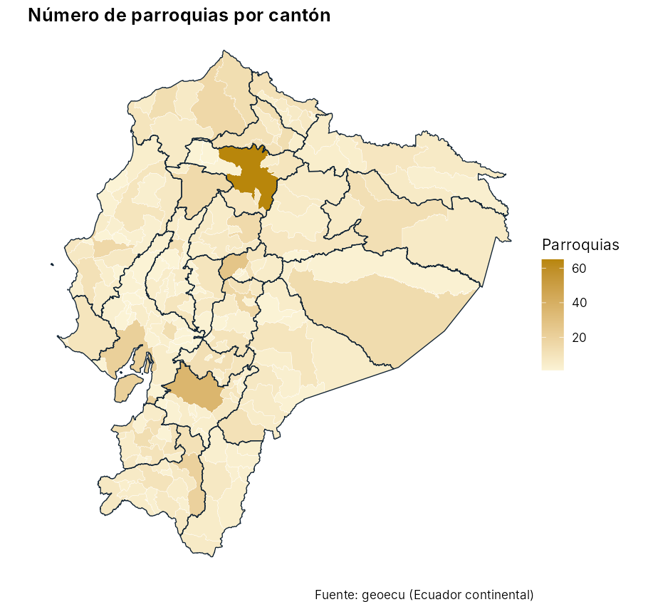

# geoecu 

<!-- badges: start -->
[](https://github.com/f-slg/geoecu/actions/workflows/R-CMD-check.yaml)
[](LICENSE.md)
<!-- badges: end -->

**geoecu** da acceso en una línea de código a las capas de **provincias,
cantones y parroquias del Ecuador**, con los **códigos oficiales de la
División Político-Administrativa (DPA)**, listas para mapear y para unir con
datos de salud, vigilancia epidemiológica o cualquier otra fuente.

- Los tres niveles **encajan exactamente**: cada cantón es la unión de sus
  parroquias y cada provincia la unión de sus cantones, sin huecos ni
  traslapes.
- Dos resoluciones: `"baja"` (3 MB, para mapas, boletines y tableros Shiny) y
  `"alta"` (para análisis espacial).
- Filtros por **nombre o código**, sin importar tildes ni mayúsculas.
- Une tus tablas por código DPA aunque los códigos vengan de Excel sin ceros a
  la izquierda.

## Instalación

```r
# install.packages("remotes")
remotes::install_github("f-slg/geoecu")
```

La primera vez que pidas una capa, geoecu descarga el GeoPackage
correspondiente (unos segundos) y lo guarda en caché. Después funciona sin
conexión.

## Uso

```r
library(geoecu)

provincias <- read_provincias()
cantones   <- read_cantones(provincia = "Loja")
parroquias <- read_parroquias(canton = "Puyango", area = "rural")

# En UTM 17S para medir áreas o distancias en metros
loja_utm <- read_cantones(provincia = 11, crs = 32717)

# Versión detallada
parroquias_alta <- read_parroquias(provincia = "Azuay", resolucion = "alta")
```

Cada capa es un objeto `sf` con estas columnas:

| Capa | Columnas |
|---|---|
| `read_provincias()` | `dpa_provin`, `provincia`, `area_km2` |
| `read_cantones()` | `dpa_canton`, `canton`, `dpa_provin`, `provincia`, `area_km2` |
| `read_parroquias()` | `dpa_parroq`, `parroquia`, `area_dpa`, `dpa_canton`, `canton`, `dpa_provin`, `provincia`, `area_km2` |

### Unir tus datos y mapear

`geoecu_unir()` une una tabla propia con la capa por código DPA. Conserva
todos los territorios, así que los que no tienen datos aparecen como `NA`.

```r
library(ggplot2)

casos <- read.csv("casos_por_canton.csv")   # columnas: cod_canton, casos
mapa  <- geoecu_unir(casos, codigo = "cod_canton", nivel = "canton")

ggplot(mapa) +
  geom_sf(aes(fill = casos), color = "white", linewidth = 0.1) +
  theme_void()
```



### Catálogo DPA y utilidades

```r
head(dpa)                                  # 1262 parroquias con sus códigos
buscar_dpa("arenal")                       # buscar por nombre o código
buscar_dpa("puyango", nivel = "canton")

formatear_codigo(c(701, 1101), "canton")   # "0701" "1101"
normalizar_nombre("Cañar ")                # "CANAR"
```

### Trabajar sin conexión o con archivos propios

```r
geoecu_usar_carpeta("C:/datos/geoecu")     # carpeta con geoecu_dpa_baja.gpkg
```

También puedes definir `GEOECU_CARPETA` en tu `.Renviron`. Para ver o borrar
la caché: `geoecu_cache_dir()` y `geoecu_limpiar_cache()`.

## Datos

| | |
|---|---|
| **Fuente** | Capa de parroquias del Ministerio de Salud Pública del Ecuador (DPA_PARROQUIA_2018 depurada, con ediciones hasta 2022). |
| **Procesamiento** | Cantones y provincias construidos disolviendo las parroquias por código DPA; simplificación topológica con [mapshaper](https://github.com/mbloch/mapshaper) (10 m en alta, 250 m en baja); reproyección a WGS84. Scripts en [`data-raw/`](data-raw/). |
| **Cobertura** | 24 provincias, 221 cantones y 1262 parroquias (440 urbanas, 822 rurales). |
| **Sistema de coordenadas** | WGS84 (EPSG:4326) por defecto. |

Las parroquias creadas o recodificadas después de la versión de origen no
aparecen. Las áreas no delimitadas se asignan según la capa de origen.

## Cómo citar

```
Salas Guerrero, R. F. (2026). geoecu: Capas geográficas de la División
Político-Administrativa del Ecuador. Paquete de R versión 0.1.0.
https://github.com/f-slg/geoecu
```

Al usar los datos, cita también al Ministerio de Salud Pública del Ecuador
como fuente de las geometrías.

## Licencia

El código se distribuye bajo licencia [MIT](LICENSE.md).
