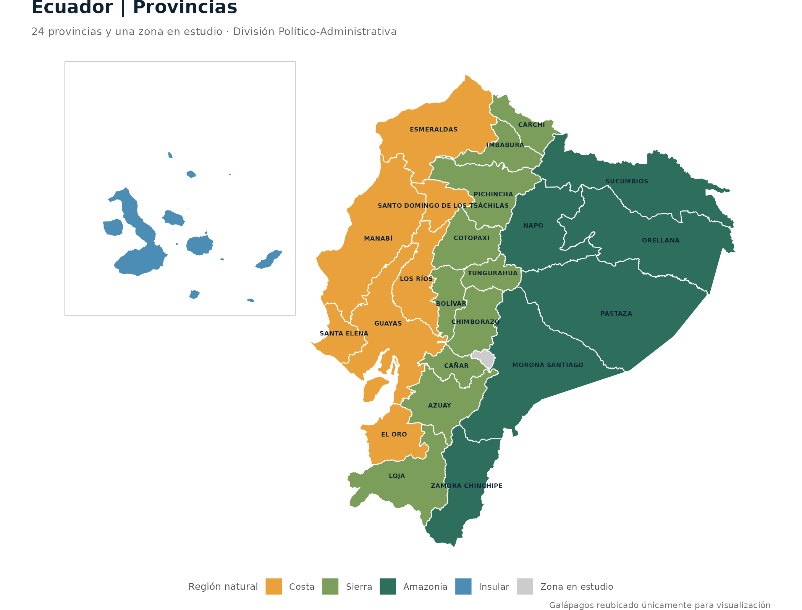
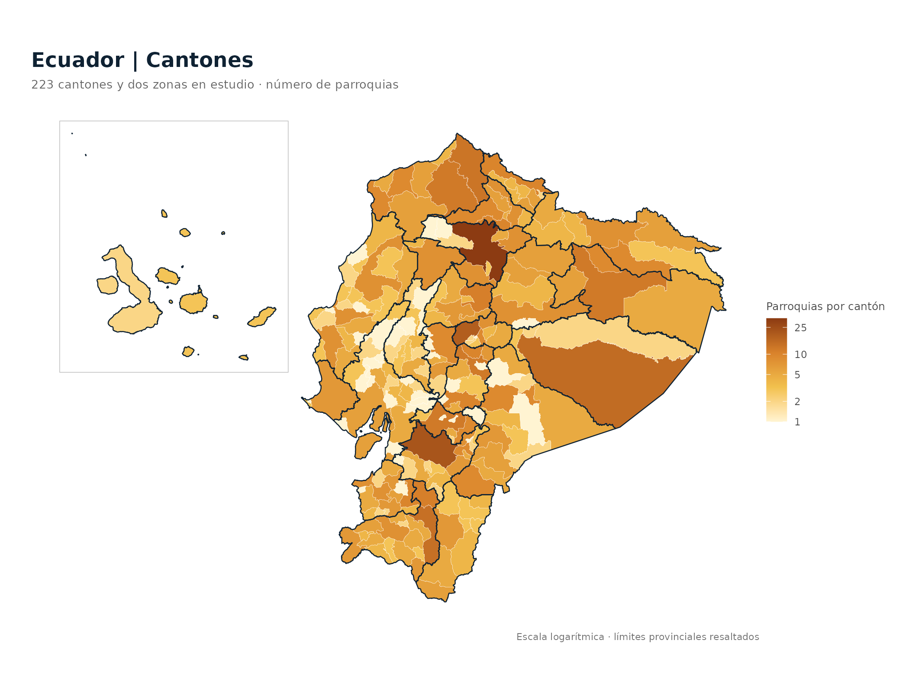
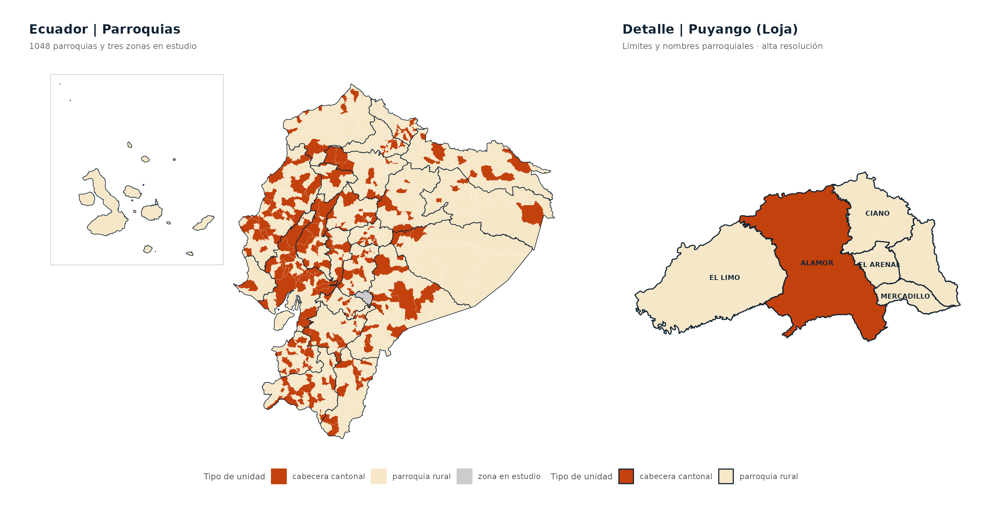

# geoecu 

<!-- badges: start -->
[](https://cran.r-project.org/package=geoecu)
[](https://github.com/f-slg/geoecu/actions/workflows/R-CMD-check.yaml)
[](https://f-slg.github.io/geoecu/)
[](https://github.com/f-slg/geoecu/blob/main/LICENSE.md)
[](https://github.com/f-slg/geoecu/blob/main/inst/COPYRIGHTS)
<!-- badges: end -->

**geoecu** da acceso en una línea de código a las capas de **provincias,
cantones y parroquias del Ecuador**, con los **códigos de la División
Político-Administrativa (DPA)**, listas para mapear y para unir con datos de
salud, vigilancia epidemiológica o cualquier otra fuente. Las capas provienen
de los [datos abiertos de la Organización Territorial del Estado](https://www.datosabiertos.gob.ec/dataset/organizacion-territorial-parroquial)
publicados por el CONALI (Ministerio de Gobierno).

> **Nota:** geoecu es un paquete independiente, desarrollado a título
> personal. No es un producto oficial de ninguna institución, ni del CONALI
> ni del Ministerio de Gobierno.
## Instalación

Ejecuta este bloque en la **consola de R o RStudio**, no en la terminal de Ubuntu. Los paquetes de visualización son opcionales para leer capas, pero necesarios para reproducir las figuras de esta página.

```r
install.packages(c("geoecu", "ggplot2", "patchwork", "scales"))
library(geoecu)
library(ggplot2)
```

**Versión en desarrollo (GitHub):**

```r
install.packages("remotes")
remotes::install_github("f-slg/geoecu")
```

En la primera lectura, las geometrías se descargan desde el [release de datos](https://github.com/f-slg/geoecu/releases/tag/datos-v0.2.0), se verifican y se conservan en caché para futuras sesiones.

<details>
<summary><strong>Ubuntu / Debian: requisitos de sf</strong></summary>

`geoecu` utiliza `sf`. Para evitar compilar bibliotecas geoespaciales en Ubuntu, puedes instalar el binario desde la **terminal de Ubuntu** antes de la instalación de R:

```bash
sudo apt update
sudo apt install r-cran-sf
```

Si compilas `sf` desde R, las dependencias del sistema incluyen `libgdal-dev`, `libgeos-dev`, `libproj-dev`, `libudunits2-dev` y `libssl-dev`.

</details>

## Primer mapa en RStudio

Tras instalar el paquete, ejecuta este ejemplo mínimo:

```r
library(geoecu)
library(ggplot2)

provincias <- read_provincias()
ggplot(provincias) +
  geom_sf(fill = "#DCEAF2", color = "#0F2233", linewidth = 0.25) +
  labs(title = "Provincias del Ecuador") +
  theme_void()
```

Este es un **mapa introductorio**, no la composición temática de la galería. Los ejemplos siguientes reproducen las imágenes detalladas con sus mismas capas y estilos.

## Qué ofrece geoecu

- **Datos actualizados**: 24 provincias, 223 cantones y 1048 parroquias
  según la Organización Territorial del Estado del 17 de julio de 2026
  (incluye el cantón Borbón y la parroquia Miss Ecuador).
- Los tres niveles **encajan exactamente**: cada cantón es la unión de sus
  parroquias y cada provincia la unión de sus cantones, sin huecos ni
  traslapes.
- Dos resoluciones: `"baja"` (3 MB, para mapas, boletines y tableros Shiny) y
  `"alta"` (39 MB, para análisis espacial).
- Filtros por **nombre o código**, sin importar tildes ni mayúsculas, con
  sugerencias cuando un nombre no existe o es ambiguo.
- Une tus tablas por código DPA aunque los códigos vengan de Excel sin ceros a
  la izquierda.
- Mapas nacionales con **Galápagos reubicado** junto al continente.
- Convierte los códigos de versiones anteriores (parroquias urbanas, antiguo
  cantón Eloy Alfaro) con `actualizar_codigo()`.
- Descarga única, verificada y en caché; después funciona sin conexión.

📖 **Documentación:** [Guía de uso](https://f-slg.github.io/geoecu/articles/guia.html) · [Galería completa](https://f-slg.github.io/geoecu/articles/galeria.html) · [Fuente de datos](https://f-slg.github.io/geoecu/articles/datos.html) · [Funciones](https://f-slg.github.io/geoecu/reference/)


## Consultas y unión con datos propios

### Leer por provincia, cantón y tipo

```r
library(geoecu)

read_cantones(provincia = "Loja")
read_parroquias(canton = "Puyango", tipo = "rural")
read_parroquias(provincia = "Loja", resolucion = "alta")

# Sistema proyectado para análisis espacial de Loja
read_cantones(provincia = "Loja", crs = 32717)
```

Cada capa es un objeto `sf` con códigos DPA y el área `area_km2`:

| Capa | Principales columnas |
|---|---|
| `read_provincias()` | `dpa_provin`, `provincia`, `tipo`, `area_km2` |
| `read_cantones()` | `dpa_canton`, `canton`, `dpa_provin`, `provincia`, `area_km2` |
| `read_parroquias()` | `dpa_parroq`, `parroquia`, `tipo`, `dpa_canton`, `canton`, `area_km2` |

### Unir una tabla propia con códigos DPA

Este ejemplo usa **datos ficticios identificados como demostración**, sin requerir un CSV que no exista en el repositorio. Sustituye `datos_demo` por tu tabla real antes de interpretar los resultados.

```r
library(geoecu)
library(ggplot2)

# Datos ficticios solo para probar la unión (NO casos reales)
datos_demo <- data.frame(
  cod_canton = c("1101", "1102", "1110"),
  eventos_demo = c(12, 4, 7)
)

mapa_demo <- geoecu_unir(
  datos_demo, codigo = "cod_canton", nivel = "canton",
  provincia = "Loja"
)

ggplot(mapa_demo) +
  geom_sf(aes(fill = eventos_demo), color = "white", linewidth = 0.2) +
  scale_fill_gradient(low = "#DCEAF2", high = "#12618A",
                      na.value = "grey90", name = "Ejemplo") +
  labs(title = "Demostración de unión DPA: Loja",
       subtitle = "Datos ficticios; no representan eventos observados") +
  theme_void()
```

Los cantones sin datos quedan con `NA`. Antes de generar mapas epidemiológicos, agrega los eventos al mismo nivel territorial y verifica la correspondencia de códigos.

### Catálogo DPA, búsqueda y limpieza

```r
head(dpa)
buscar_dpa("arenal")
buscar_dpa("puyango", nivel = "canton")
formatear_codigo(c(701, 1101), "canton")
normalizar_nombre("Cañar ")
```

### Códigos de versiones anteriores

En la versión 0.4.0 las parroquias urbanas forman parte de su **cabecera cantonal**. Para actualizar códigos de versiones anteriores y revisar las equivalencias:

```r
actualizar_codigo(c("010101", "080253"))
subset(dpa_equivalencias, cambio == "código distinto")
```

### Datos sin conexión

```r
# Ver dónde se guardan las capas ya descargadas
geoecu_cache_dir()
geoecu_datos_disponibles()

# Si tienes GeoPackages propios, indica una carpeta que exista:
# geoecu_usar_carpeta("~/datos/geoecu")
```

## Galería de mapas y código reproducible

Las cinco imágenes siguientes se generan con los datos abiertos de CONALI disponibles en `geoecu`. **Cada bloque de R es autónomo:** cópialo en RStudio para obtener la misma composición, paleta, capas, etiquetas y leyenda de la figura. El tamaño del panel *Plots* puede cambiar la distribución visual; cada ejemplo incluye la instrucción opcional de exportación con las dimensiones de la imagen publicada.

| Nivel | Función principal | Cobertura |
|---|---|---|
| Provincias | `read_provincias()` | 24 provincias + 1 zona en estudio |
| Cantones | `read_cantones()` | 223 cantones + 2 zonas en estudio |
| Parroquias | `read_parroquias()` | 1048 parroquias + 3 zonas en estudio |

### 1. Provincias: regiones naturales y límites

Muestra **24 provincias** y una zona en estudio. Los colores reflejan regiones naturales y los nombres provinciales aparecen sobre el continente.



<details>
<summary><strong>Ver y copiar el código R exacto de esta figura</strong></summary>

```r
library(geoecu)
library(ggplot2)

azul   <- "#0F2233"
dorado <- "#F2B705"

tema <- theme_void(base_size = 12) +
  theme(plot.title = element_text(face = "bold", size = 13, color = azul,
                                  hjust = 0.5, margin = margin(t = 3, b = 7, l = 4, r = 4)),
        plot.subtitle = element_text(size = 9.5, color = "grey40",
                                     hjust = 0.5, margin = margin(b = 5, l = 4, r = 4)),
        legend.position = "bottom",
        legend.title = element_text(size = 9, color = "grey30"),
        legend.text = element_text(size = 8.5, color = "grey30"),
        plot.title.position = "plot",
        plot.margin = margin(t = 18, r = 20, b = 18, l = 22, unit = "pt"),
        plot.background = element_rect(fill = "white", color = NA))

marco <- function(capa) {
  geom_sf(data = marco_galapagos(capa), fill = NA, color = "grey78",
          linewidth = 0.3)
}

region <- data.frame(
  dpa_provin = sprintf("%02d", 1:24),
  region = c("Sierra", "Sierra", "Sierra", "Sierra", "Sierra", "Sierra",
             "Costa", "Costa", "Costa", "Sierra", "Sierra", "Costa",
             "Costa", "Amazonía", "Amazonía", "Amazonía", "Sierra",
             "Sierra", "Amazonía", "Insular", "Amazonía", "Amazonía",
             "Costa", "Costa")
)
region <- rbind(region, data.frame(dpa_provin = "90", region = "Zona en estudio"))
region$region <- factor(region$region,
                        levels = c("Costa", "Sierra", "Amazonía", "Insular",
                                   "Zona en estudio"))

prov <- reubicar_galapagos(read_provincias(crs = 32717))
p_prov <- merge(prov, region, by = "dpa_provin")

prov_etiquetas <- prov[prov$tipo == "provincia" & prov$dpa_provin != "20", ]
p_provincias <- ggplot() +
  geom_sf(data = p_prov, aes(fill = region), color = "white", linewidth = 0.4) +
  geom_sf_text(data = prov_etiquetas, aes(label = provincia),
               color = azul, size = 2.1, fontface = "bold",
               check_overlap = TRUE) +
  marco(prov) +
  scale_fill_manual(values = c(Costa = "#E9A23B", Sierra = "#7B9E5A",
                               "Amazonía" = "#2E6E5C", Insular = "#4C8DB5",
                               "Zona en estudio" = "grey80"),
                    name = "Región natural", drop = FALSE,
                    guide = guide_legend(nrow = 1)) +
  labs(title = "Ecuador | Provincias",
       subtitle = "24 provincias y una zona en estudio · División Político-Administrativa",
       caption = "Galápagos reubicado únicamente para visualización") +
  tema +
  theme(legend.position = "bottom",
        plot.title = element_text(hjust = 0, face = "bold", size = 17),
        plot.subtitle = element_text(hjust = 0, size = 10),
        plot.caption = element_text(size = 8, color = "grey45"))

print(p_provincias)
# Exportación idéntica: 10.5 x 8 pulgadas y 200 dpi
# ggsave("mapa_provincias.png", p_provincias, width = 10.5, height = 8, dpi = 200)
```

</details>

### 2. Cantones: parroquias por cantón

Mapa temático de **223 cantones** y dos zonas en estudio, con un indicador verificable obtenido directamente del catálogo `dpa`. La escala de colores es **logarítmica**.



<details>
<summary><strong>Ver y copiar el código R exacto de esta figura</strong></summary>

```r
library(geoecu)
library(ggplot2)

azul   <- "#0F2233"
dorado <- "#F2B705"

tema <- theme_void(base_size = 12) +
  theme(plot.title = element_text(face = "bold", size = 13, color = azul,
                                  hjust = 0.5, margin = margin(t = 3, b = 7, l = 4, r = 4)),
        plot.subtitle = element_text(size = 9.5, color = "grey40",
                                     hjust = 0.5, margin = margin(b = 5, l = 4, r = 4)),
        legend.position = "bottom",
        legend.title = element_text(size = 9, color = "grey30"),
        legend.text = element_text(size = 8.5, color = "grey30"),
        plot.title.position = "plot",
        plot.margin = margin(t = 18, r = 20, b = 18, l = 22, unit = "pt"),
        plot.background = element_rect(fill = "white", color = NA))

marco <- function(capa) {
  geom_sf(data = marco_galapagos(capa), fill = NA, color = "grey78",
          linewidth = 0.3)
}

prov <- reubicar_galapagos(read_provincias(crs = 32717))
cant <- reubicar_galapagos(read_cantones(crs = 32717))
n_parr <- as.data.frame(table(dpa_canton = dpa$dpa_canton), stringsAsFactors = FALSE)
names(n_parr)[2] <- "parroquias"
c_parr <- merge(cant, n_parr, by = "dpa_canton")

p_cantones <- ggplot() +
  geom_sf(data = c_parr, aes(fill = parroquias),
          color = "white", linewidth = 0.08) +
  geom_sf(data = prov, fill = NA, color = azul, linewidth = 0.42) +
  marco(prov) +
  scale_fill_gradientn(
    colours = c("#FFF4D2", "#F2C14E", "#D9822B", "#8C3B12"),
    trans = "log10", breaks = c(1, 2, 5, 10, 25, 50),
    name = "Parroquias por cantón", na.value = "grey85"
  ) +
  labs(title = "Ecuador | Cantones",
       subtitle = "223 cantones y dos zonas en estudio · número de parroquias",
       caption = "Escala logarítmica · límites provinciales resaltados") +
  tema +
  theme(legend.position = "right",
        plot.title = element_text(hjust = 0, face = "bold", size = 17),
        plot.subtitle = element_text(hjust = 0, size = 10),
        plot.caption = element_text(size = 8, color = "grey45"))

print(p_cantones)
# ggsave("mapa_cantones.png", p_cantones, width = 10.5, height = 8, dpi = 200)
```

</details>

### 3. Parroquias: mapa nacional y detalle de Puyango

Combina dos vistas: clasificación de **1048 parroquias** y tres zonas en estudio, y detalle de **Puyango (Loja)** con sus nombres parroquiales en resolución alta.



<details>
<summary><strong>Ver y copiar el código R exacto de esta figura</strong></summary>

```r
library(geoecu)
library(ggplot2)
library(patchwork)

azul   <- "#0F2233"
dorado <- "#F2B705"

tema <- theme_void(base_size = 12) +
  theme(plot.title = element_text(face = "bold", size = 13, color = azul,
                                  hjust = 0.5, margin = margin(t = 3, b = 7, l = 4, r = 4)),
        plot.subtitle = element_text(size = 9.5, color = "grey40",
                                     hjust = 0.5, margin = margin(b = 5, l = 4, r = 4)),
        legend.position = "bottom",
        legend.title = element_text(size = 9, color = "grey30"),
        legend.text = element_text(size = 8.5, color = "grey30"),
        plot.title.position = "plot",
        plot.margin = margin(t = 18, r = 20, b = 18, l = 22, unit = "pt"),
        plot.background = element_rect(fill = "white", color = NA))

marco <- function(capa) {
  geom_sf(data = marco_galapagos(capa), fill = NA, color = "grey78",
          linewidth = 0.3)
}

prov <- reubicar_galapagos(read_provincias(crs = 32717))
parr <- reubicar_galapagos(read_parroquias(crs = 32717))

p_parroquias <- ggplot() +
  geom_sf(data = parr, aes(fill = tipo), color = "white", linewidth = 0.04) +
  geom_sf(data = prov, fill = NA, color = azul, linewidth = 0.3) +
  marco(prov) +
  scale_fill_manual(values = c("cabecera cantonal" = "#C2410C",
                               "parroquia rural" = "#F6E7C8",
                               "zona en estudio" = "grey80"),
                    name = "Tipo de unidad") +
  labs(title = "Ecuador | Parroquias",
       subtitle = "1048 parroquias y tres zonas en estudio") +
  tema +
  theme(plot.title = element_text(hjust = 0, face = "bold", size = 14),
        plot.subtitle = element_text(hjust = 0, size = 9))

puyango <- read_parroquias(provincia = "Loja", canton = "Puyango",
                           resolucion = "alta", crs = 32717)
p_detalle <- ggplot(puyango) +
  geom_sf(aes(fill = tipo), color = azul, linewidth = 0.55) +
  geom_sf_text(aes(label = parroquia), color = azul,
               size = 2.6, fontface = "bold", check_overlap = TRUE) +
  scale_fill_manual(values = c("cabecera cantonal" = "#C2410C",
                               "parroquia rural" = "#F6E7C8"),
                    name = "Tipo de unidad") +
  labs(title = "Detalle | Puyango (Loja)",
       subtitle = "Límites y nombres parroquiales · alta resolución") +
  tema +
  theme(plot.title = element_text(hjust = 0, face = "bold", size = 14),
        plot.subtitle = element_text(hjust = 0, size = 9))

panel_parroquial <- (p_parroquias | p_detalle) +
  plot_layout(widths = c(1.55, 1), guides = "collect") &
  theme(legend.position = "bottom")

print(panel_parroquial)
# ggsave("mapa_parroquias.png", panel_parroquial, width = 15, height = 7.6, dpi = 200)
```

</details>

### 4. Galápagos: mapa nacional con recuadro

El recuadro muestra **Galápagos reubicado**, superpuesto a un mapa de cantones coloreados por número de parroquias. Es una composición **solo para visualización**, no para cálculos de área o distancias.


<details>
<summary><strong>Ver y copiar el código R exacto de esta figura</strong></summary>

```r
library(geoecu)
library(ggplot2)

azul   <- "#0F2233"
dorado <- "#F2B705"

tema <- theme_void(base_size = 12) +
  theme(plot.title = element_text(face = "bold", size = 13, color = azul,
                                  hjust = 0.5, margin = margin(t = 3, b = 7, l = 4, r = 4)),
        plot.subtitle = element_text(size = 9.5, color = "grey40",
                                     hjust = 0.5, margin = margin(b = 5, l = 4, r = 4)),
        legend.position = "bottom",
        legend.title = element_text(size = 9, color = "grey30"),
        legend.text = element_text(size = 8.5, color = "grey30"),
        plot.title.position = "plot",
        plot.margin = margin(t = 18, r = 20, b = 18, l = 22, unit = "pt"),
        plot.background = element_rect(fill = "white", color = NA))

marco <- function(capa) {
  geom_sf(data = marco_galapagos(capa), fill = NA, color = "grey78",
          linewidth = 0.3)
}

n_parr <- as.data.frame(table(dpa_canton = dpa$dpa_canton), stringsAsFactors = FALSE)
names(n_parr)[2] <- "parroquias"
mapa <- geoecu_unir(n_parr, "dpa_canton", "canton", crs = 32717) |>
  reubicar_galapagos()
prov <- reubicar_galapagos(read_provincias(crs = 32717))

g_nac <- ggplot() +
  geom_sf(data = mapa, aes(fill = parroquias), color = "white", linewidth = 0.12) +
  geom_sf(data = prov, fill = NA, color = azul, linewidth = 0.3) +
  marco(prov) +
  scale_fill_gradientn(colours = c("#FFF4D2", "#F2C14E", "#D9822B", "#8C3B12"),
                       trans = "log10", breaks = c(2, 5, 10, 25, 60),
                       name = "Parroquias") +
  labs(title = "Número de parroquias por cantón",
       subtitle = "geoecu_unir() + reubicar_galapagos()") +
  tema + theme(legend.position = "right",
               plot.title = element_text(hjust = 0),
               plot.subtitle = element_text(hjust = 0, family = "mono"))

print(g_nac)
# ggsave("mapa_nacional.png", g_nac, width = 9.5, height = 7.5, dpi = 200)
```

</details>

### 5. Loja: límites cantonales y parroquiales

Ejemplo de detalle con los **16 cantones y 94 parroquias de Loja**, límites cantonales resaltados y nombres de cantón. Se utilizan las capas de alta resolución.


<details>
<summary><strong>Ver y copiar el código R exacto de esta figura</strong></summary>

```r
library(geoecu)
library(ggplot2)

azul   <- "#0F2233"
dorado <- "#F2B705"

tema <- theme_void(base_size = 12) +
  theme(plot.title = element_text(face = "bold", size = 13, color = azul,
                                  hjust = 0.5, margin = margin(t = 3, b = 7, l = 4, r = 4)),
        plot.subtitle = element_text(size = 9.5, color = "grey40",
                                     hjust = 0.5, margin = margin(b = 5, l = 4, r = 4)),
        legend.position = "bottom",
        legend.title = element_text(size = 9, color = "grey30"),
        legend.text = element_text(size = 8.5, color = "grey30"),
        plot.title.position = "plot",
        plot.margin = margin(t = 18, r = 20, b = 18, l = 22, unit = "pt"),
        plot.background = element_rect(fill = "white", color = NA))

marco <- function(capa) {
  geom_sf(data = marco_galapagos(capa), fill = NA, color = "grey78",
          linewidth = 0.3)
}

loja_p <- read_parroquias(provincia = "Loja", resolucion = "alta", crs = 32717)
loja_c <- read_cantones(provincia = "Loja", resolucion = "alta", crs = 32717)

loja_p$canton <- factor(loja_p$canton)
g_loja <- ggplot() +
  geom_sf(data = loja_p, aes(fill = canton), color = "white", linewidth = 0.2) +
  geom_sf(data = loja_c, fill = NA, color = azul, linewidth = 0.5) +
  geom_sf_label(data = loja_c, aes(label = canton), size = 2.3, color = azul,
                fontface = "bold", fill = scales::alpha("white", 0.8),
                linewidth = 0, label.padding = unit(0.12, "lines")) +
  scale_fill_manual(values = grDevices::hcl.colors(16, "Set 3"), guide = "none") +
  labs(title = sprintf("Provincia de Loja: %d cantones y %d parroquias",
                       nrow(loja_c), nrow(loja_p)),
       subtitle = "read_parroquias(provincia = \"Loja\", resolucion = \"alta\")") +
  tema + theme(plot.title = element_text(hjust = 0),
               plot.subtitle = element_text(hjust = 0, family = "mono"),
               plot.margin = margin(t = 18, r = 20, b = 18, l = 22, unit = "pt"))

print(g_loja)
# ggsave("mapa_loja.png", g_loja, width = 8, height = 8, dpi = 200)
```

</details>

> **Nota:** `reubicar_galapagos()` altera las coordenadas únicamente para mapas con recuadro. Para mediciones espaciales utiliza las capas originales sin reubicar.

**[Consulta la guía de uso](https://f-slg.github.io/geoecu/articles/guia.html)** · **[Galería web](https://f-slg.github.io/geoecu/articles/galeria.html)** · **[Generador original de figuras](data-raw/03_figuras_readme.R)**


## Datos

| | |
|---|---|
| **Fuente** | [Organización Territorial del Estado](https://www.datosabiertos.gob.ec/dataset/organizacion-territorial-parroquial), Comité Nacional de Límites Internos (CONALI), Ministerio de Gobierno del Ecuador. Versión del 17 de julio de 2026. Datos abiertos, licencia CC BY. |
| **Figuras** | Las imágenes de este README se generan con [`data-raw/03_figuras_readme.R`](https://github.com/f-slg/geoecu/blob/main/data-raw/03_figuras_readme.R) a partir de los datos del paquete. |
| **Procesamiento** | Cantones y provincias construidos disolviendo las parroquias por código DPA; se excluye un polígono sin código ("ISLA"); simplificación topológica con [mapshaper](https://github.com/mbloch/mapshaper) (10 m en alta, 250 m en baja); reproyección a WGS84. Scripts en [`data-raw/`](https://github.com/f-slg/geoecu/tree/main/data-raw). |
| **Cobertura** | 24 provincias, 223 cantones y 1048 parroquias (223 cabeceras cantonales y 825 rurales), más 3 zonas en estudio. |
| **Sistema de coordenadas** | WGS84 (EPSG:4326) por defecto. |

Las parroquias urbanas forman parte de su cabecera cantonal. Las
circunscripciones creadas después de la versión de origen no aparecen hasta la
siguiente actualización de datos.

## Cómo citar

```r
citation("geoecu")
```

Al usar los datos, cita también la fuente, como pide el CONALI:

```
Comité Nacional de Límites Internos (CONALI), Ministerio de Gobierno del
Ecuador. Límites territoriales de la Organización Territorial del Estado
interparroquiales, aprobados por el Directorio del CONALI en sesión ordinaria
del 24 de marzo de 2022, 17 de enero de 2023 y 13 de marzo de 2026. Datos
abiertos, licencia CC BY.
```

## Contribuir

Las preguntas de uso van en [Discussions](https://github.com/f-slg/geoecu/discussions/categories/q-a),
y los errores y propuestas en [issues](https://github.com/f-slg/geoecu/issues/new/choose).
Consulta la [guía de contribución](https://github.com/f-slg/geoecu/blob/main/.github/CONTRIBUTING.md).
Este proyecto sigue un [código de conducta](https://github.com/f-slg/geoecu/blob/main/.github/CODE_OF_CONDUCT.md):
al participar, te comprometes a respetarlo.

## Licencia

El código se distribuye bajo licencia [MIT](https://github.com/f-slg/geoecu/blob/main/LICENSE.md).
Los datos son del CONALI, con licencia CC BY; ver
[`inst/COPYRIGHTS`](https://github.com/f-slg/geoecu/blob/main/inst/COPYRIGHTS).
