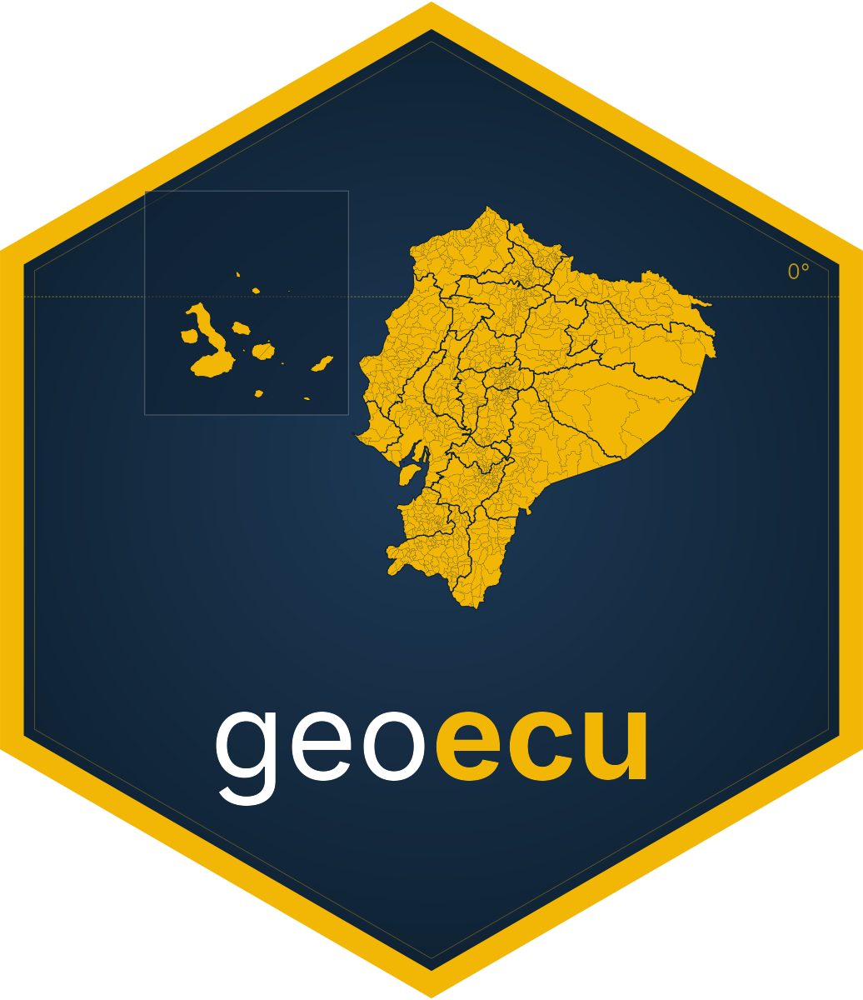
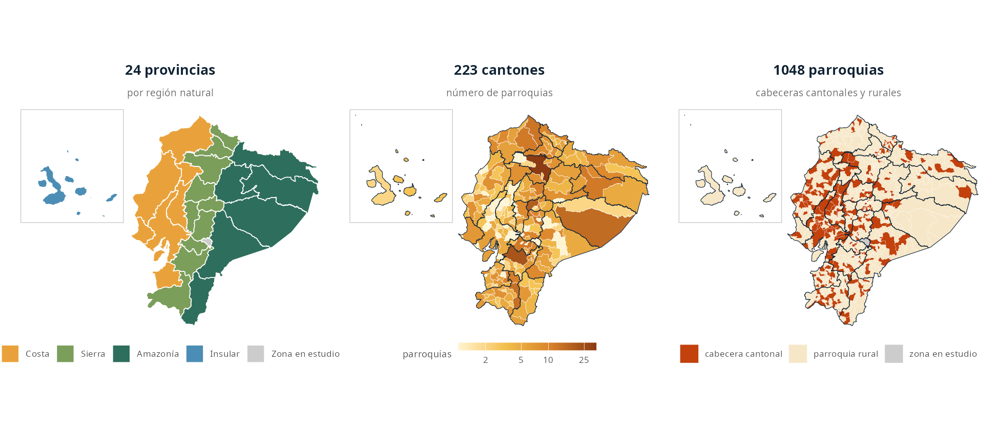
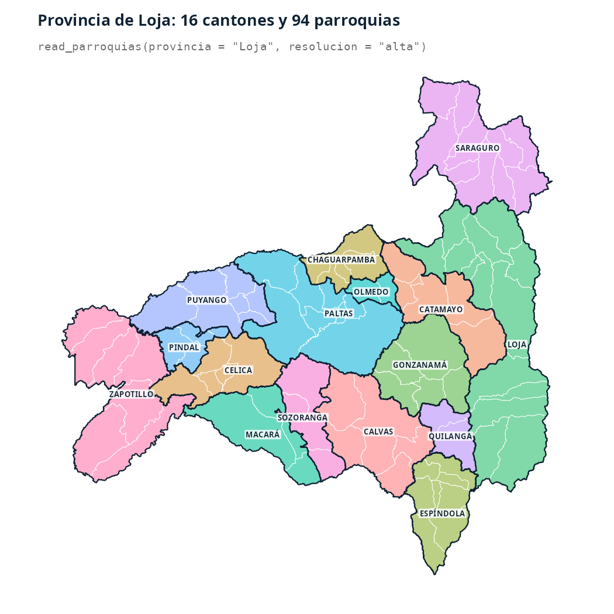
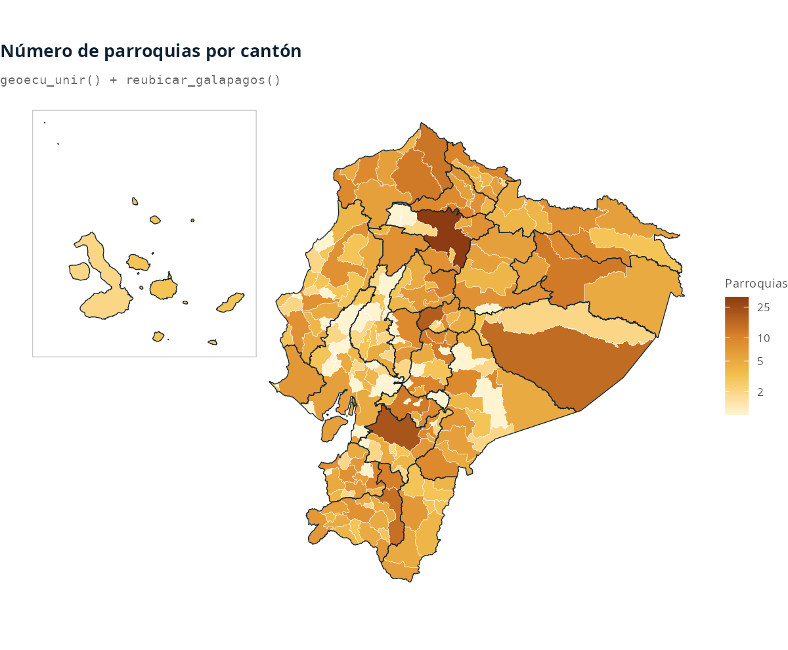

# geoecu 

<!-- badges: start -->
[](https://cran.r-project.org/package=geoecu)
[](https://github.com/f-slg/geoecu/actions/workflows/R-CMD-check.yaml)
[](https://f-slg.github.io/geoecu/)
[](https://github.com/f-slg/geoecu/blob/main/LICENSE.md)
[](https://github.com/f-slg/geoecu/blob/main/inst/COPYRIGHTS)
<!-- badges: end -->

**geoecu** da acceso en una línea de código a las capas de **provincias,
cantones y parroquias del Ecuador**, con los **códigos de la División
Político-Administrativa (DPA)**, listas para mapear y para unir con datos de
salud, vigilancia epidemiológica o cualquier otra fuente. Las capas provienen
de los [datos abiertos de la Organización Territorial del Estado](https://www.datosabiertos.gob.ec/dataset/organizacion-territorial-parroquial)
publicados por el CONALI (Ministerio de Gobierno).

> **Nota:** geoecu es un paquete independiente, desarrollado a título
> personal. No es un producto oficial de ninguna institución, ni del CONALI
> ni del Ministerio de Gobierno.

- **Datos actualizados**: 24 provincias, 223 cantones y 1048 parroquias
  según la Organización Territorial del Estado del 17 de julio de 2026
  (incluye el cantón Borbón y la parroquia Miss Ecuador).
- Los tres niveles **encajan exactamente**: cada cantón es la unión de sus
  parroquias y cada provincia la unión de sus cantones, sin huecos ni
  traslapes.
- Dos resoluciones: `"baja"` (3 MB, para mapas, boletines y tableros Shiny) y
  `"alta"` (39 MB, para análisis espacial).
- Filtros por **nombre o código**, sin importar tildes ni mayúsculas, con
  sugerencias cuando un nombre no existe o es ambiguo.
- Une tus tablas por código DPA aunque los códigos vengan de Excel sin ceros a
  la izquierda.
- Mapas nacionales con **Galápagos reubicado** junto al continente.
- Convierte los códigos de versiones anteriores (parroquias urbanas, antiguo
  cantón Eloy Alfaro) con `actualizar_codigo()`.
- Descarga única, verificada y en caché; después funciona sin conexión.

📖 **Documentación completa:** [Guía de uso](https://f-slg.github.io/geoecu/articles/guia.html) ·
[Datos y fuente](https://f-slg.github.io/geoecu/articles/datos.html) ·
[Referencia de funciones](https://f-slg.github.io/geoecu/reference/)



## Instalación

```r
# Desde CRAN
install.packages("geoecu")

# Versión en desarrollo
# install.packages("remotes")
remotes::install_github("f-slg/geoecu")
```

La primera vez que pidas una capa, geoecu descarga el GeoPackage
correspondiente (unos segundos) y lo guarda en caché. Después funciona sin
conexión.

### Usuarios de Linux

geoecu depende de [`sf`](https://r-spatial.github.io/sf/). En Windows y macOS,
CRAN ofrece `sf` ya compilado y se instala en un minuto. En Linux, CRAN solo
publica el código fuente y R lo compila al instalarlo, lo que puede tardar
entre 15 y 30 minutos la primera vez.

Para evitar esa espera, instala `sf` ya compilado desde los repositorios del
sistema **antes** de instalar geoecu:

```bash
# Ubuntu / Debian
sudo apt install r-cran-sf

# Fedora
sudo dnf install R-sf
```

Si prefieres compilarlo desde R, instala primero las librerías del sistema
que necesita:

```bash
# Ubuntu / Debian
sudo apt install libgdal-dev libgeos-dev libproj-dev libudunits2-dev libssl-dev
```

## Uso

```r
library(geoecu)

provincias <- read_provincias()
cantones   <- read_cantones(provincia = "Loja")
parroquias <- read_parroquias(canton = "Puyango", tipo = "rural")

# En UTM 17S para medir áreas o distancias en metros
loja_utm <- read_cantones(provincia = 11, crs = 32717)

# Versión detallada
parroquias_alta <- read_parroquias(provincia = "Loja", resolucion = "alta")
```



Cada capa es un objeto `sf` con estas columnas:

| Capa | Columnas |
|---|---|
| `read_provincias()` | `dpa_provin`, `provincia`, `tipo`, `area_km2` |
| `read_cantones()` | `dpa_canton`, `canton`, `tipo`, `dpa_provin`, `provincia`, `area_km2` |
| `read_parroquias()` | `dpa_parroq`, `parroquia`, `tipo`, `dpa_canton`, `canton`, `dpa_provin`, `provincia`, `area_km2` |

La columna `tipo` distingue las circunscripciones (`"provincia"`, `"cantón"`,
`"cabecera cantonal"`, `"parroquia rural"`) de las **zonas en estudio**,
territorios con límites aún no resueltos que se incluyen para que el mapa no
tenga huecos. Para excluirlas: `subset(x, tipo != "zona en estudio")`.

### Unir tus datos y mapear

`geoecu_unir()` une una tabla propia con la capa por código DPA. Conserva
todos los territorios, así que los que no tienen datos aparecen como `NA`.

```r
library(ggplot2)

casos <- read.csv("casos_por_canton.csv")   # columnas: cod_canton, casos
mapa  <- geoecu_unir(casos, codigo = "cod_canton", nivel = "canton")

ggplot(mapa) +
  geom_sf(aes(fill = casos), color = "white", linewidth = 0.1) +
  theme_void()
```

### Mapas nacionales con Galápagos

`reubicar_galapagos()` traslada las islas a la esquina superior izquierda,
junto al continente, y `marco_galapagos()` devuelve el recuadro para
dibujarlo. Funciona con los tres niveles y con capas unidas con
`geoecu_unir()`; si reubicas varias capas, quedan alineadas entre sí.

```r
n_parr <- as.data.frame(table(dpa_canton = dpa$dpa_canton))
names(n_parr)[2] <- "parroquias"

mapa <- geoecu_unir(n_parr, "dpa_canton", "canton", crs = 32717) |>
  reubicar_galapagos()
prov <- reubicar_galapagos(read_provincias(crs = 32717))

ggplot() +
  geom_sf(data = mapa, aes(fill = parroquias), color = "white", linewidth = 0.1) +
  geom_sf(data = prov, fill = NA, color = "#0F2233", linewidth = 0.3) +
  geom_sf(data = marco_galapagos(prov), fill = NA, color = "grey78", linewidth = 0.3) +
  scale_fill_gradientn(colours = c("#FFF4D2", "#F2C14E", "#D9822B", "#8C3B12"),
                       trans = "log10") +
  theme_void()
```



El traslado es solo para visualizar: para medir áreas o distancias usa las
capas sin reubicar.

### Catálogo DPA y utilidades

```r
head(dpa)                                  # 1051 parroquias y zonas con sus códigos
buscar_dpa("arenal")                       # buscar por nombre o código
buscar_dpa("puyango", nivel = "canton")

formatear_codigo(c(701, 1101), "canton")   # "0701" "1101"
normalizar_nombre("Cañar ")                # "CANAR"
```

### Códigos de versiones anteriores

Desde la versión 0.4.0, geoecu usa la Organización Territorial del Estado del
CONALI, que no subdivide las cabeceras cantonales en parroquias urbanas e
incluye el cantón Borbón y nuevas parroquias rurales. Si tus tablas usan los
códigos de versiones anteriores, `actualizar_codigo()` los convierte y
`dpa_equivalencias` muestra la correspondencia completa:

```r
actualizar_codigo(c("010101", "080253"))   # "010150" (cabecera de Cuenca), "080950" (Borbón)
subset(dpa_equivalencias, cambio == "código distinto")
```

### Trabajar sin conexión o con archivos propios

```r
geoecu_usar_carpeta("C:/datos/geoecu")     # carpeta con geoecu_dpa_baja.gpkg
```

También puedes definir `GEOECU_CARPETA` en tu `.Renviron`. Para ver o borrar
la caché: `geoecu_cache_dir()` y `geoecu_limpiar_cache()`.

## Datos

| | |
|---|---|
| **Fuente** | [Organización Territorial del Estado](https://www.datosabiertos.gob.ec/dataset/organizacion-territorial-parroquial), Comité Nacional de Límites Internos (CONALI), Ministerio de Gobierno del Ecuador. Versión del 17 de julio de 2026. Datos abiertos, licencia CC BY. |
| **Figuras** | Las imágenes de este README se generan con [`data-raw/03_figuras_readme.R`](https://github.com/f-slg/geoecu/blob/main/data-raw/03_figuras_readme.R) a partir de los datos del paquete. |
| **Procesamiento** | Cantones y provincias construidos disolviendo las parroquias por código DPA; se excluye un polígono sin código ("ISLA"); simplificación topológica con [mapshaper](https://github.com/mbloch/mapshaper) (10 m en alta, 250 m en baja); reproyección a WGS84. Scripts en [`data-raw/`](https://github.com/f-slg/geoecu/tree/main/data-raw). |
| **Cobertura** | 24 provincias, 223 cantones y 1048 parroquias (223 cabeceras cantonales y 825 rurales), más 3 zonas en estudio. |
| **Sistema de coordenadas** | WGS84 (EPSG:4326) por defecto. |

Las parroquias urbanas forman parte de su cabecera cantonal. Las
circunscripciones creadas después de la versión de origen no aparecen hasta la
siguiente actualización de datos.

## Cómo citar

```r
citation("geoecu")
```

Al usar los datos, cita también la fuente, como pide el CONALI:

```
Comité Nacional de Límites Internos (CONALI), Ministerio de Gobierno del
Ecuador. Límites territoriales de la Organización Territorial del Estado
interparroquiales, aprobados por el Directorio del CONALI en sesión ordinaria
del 24 de marzo de 2022, 17 de enero de 2023 y 13 de marzo de 2026. Datos
abiertos, licencia CC BY.
```

## Contribuir

Las preguntas de uso van en [Discussions](https://github.com/f-slg/geoecu/discussions/categories/q-a),
y los errores y propuestas en [issues](https://github.com/f-slg/geoecu/issues/new/choose).
Consulta la [guía de contribución](https://github.com/f-slg/geoecu/blob/main/.github/CONTRIBUTING.md).
Este proyecto sigue un [código de conducta](https://github.com/f-slg/geoecu/blob/main/.github/CODE_OF_CONDUCT.md):
al participar, te comprometes a respetarlo.

## Licencia

El código se distribuye bajo licencia [MIT](https://github.com/f-slg/geoecu/blob/main/LICENSE.md).
Los datos son del CONALI, con licencia CC BY; ver
[`inst/COPYRIGHTS`](https://github.com/f-slg/geoecu/blob/main/inst/COPYRIGHTS).
