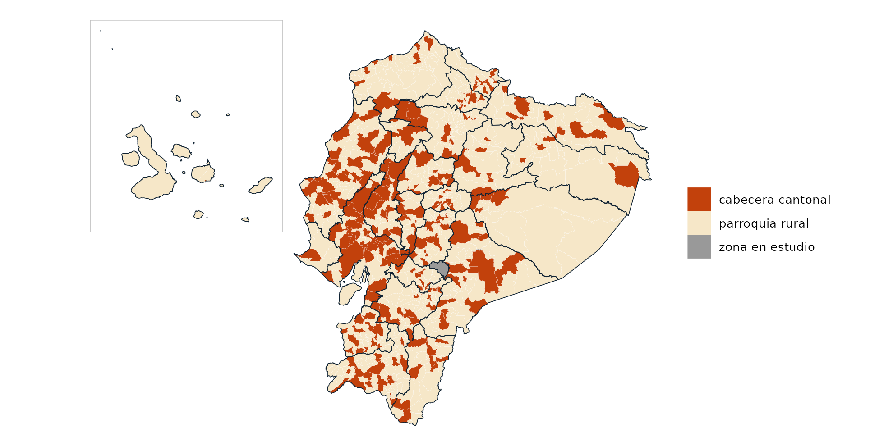

# Datos: fuente y procesamiento

``` r

library(geoecu)
library(ggplot2)
```

## Fuente

Las capas de geoecu se construyen a partir de la **Organización
Territorial del Estado** (OTE) que mantiene el **Comité Nacional de
Límites Internos (CONALI)**, a través de la Dirección de Límites
Territoriales Internos del **Ministerio de Gobierno** del Ecuador.

|  |  |
|----|----|
| **Capa** | `ORGANIZACION_TERRITORIAL_PARROQUIAL` |
| **Versión** | 17 de julio de 2026 |
| **Publicación** | [Portal de datos abiertos del Ecuador](https://www.datosabiertos.gob.ec/dataset/organizacion-territorial-parroquial) |
| **Licencia** | Creative Commons Atribución (CC BY) |
| **Escala de origen** | 1:5.000 y 1:50.000, sobre cartografía base oficial |
| **Sistema de origen** | WGS 84 / UTM zona 17 Sur (EPSG:32717) |

Según los metadatos de la capa, el acceso es **sin restricción** y el
Directorio del CONALI autoriza su publicación por cualquier medio, con
la condición de citar la fuente:

> Límites territoriales de la Organización Territorial del Estado
> interparroquiales, aprobados por el Directorio del CONALI en sesión
> ordinaria del 24 de marzo de 2022, 17 de enero de 2023 y 13 de marzo
> de 2026.

geoecu es un paquete independiente: **no es un producto oficial** del
CONALI ni del Ministerio de Gobierno, que no lo respaldan. La
información oficial y vigente sobre límites internos es la que publica
el CONALI.

## Procesamiento

Los scripts están en
[`data-raw/`](https://github.com/f-slg/geoecu/tree/main/data-raw) del
repositorio y se ejecutan en este orden:

1.  **`01_simplificar.sh`** (con
    [mapshaper](https://github.com/mbloch/mapshaper)):
    - Lee la capa parroquial y excluye el polígono sin código numérico
      (`"ISLA"`, un islote de 11 km² frente a la costa de Manabí).
    - Limpia la topología y simplifica las geometrías conservando la
      forma de todos los polígonos: tolerancia de **10 m** (resolución
      alta) y **250 m** (resolución baja).
    - Construye cantones y provincias **disolviendo las parroquias** por
      código DPA. Por eso los tres niveles encajan exactamente.
    - Reproyecta a WGS84 (EPSG:4326).
2.  **`02_construir_datos.R`**: renombra columnas, asigna el `tipo` de
    cada unidad, calcula `area_km2` en UTM 17S sobre la resolución alta
    y escribe los GeoPackages `geoecu_dpa_baja.gpkg` y
    `geoecu_dpa_alta.gpkg` y el catálogo `dpa`.
3.  **`03_figuras_readme.R`**: figuras del README.
4.  **`04_equivalencias.R`**: tabla `dpa_equivalencias` con la versión
    anterior.
5.  **`05_logo.R`**: logo y favicons del sitio.

Los GeoPackages se publican en el release
[`datos-v0.2.0`](https://github.com/f-slg/geoecu/releases/tag/datos-v0.2.0).
geoecu verifica la huella MD5 de cada descarga antes de guardarla en
caché.

## Cobertura

``` r

table(dpa$tipo)
#> 
#> cabecera cantonal   parroquia rural   zona en estudio 
#>               223               825                 3
length(unique(dpa$dpa_canton[dpa$tipo != "zona en estudio"]))   # cantones
#> [1] 223
length(unique(dpa$dpa_provin[dpa$tipo != "zona en estudio"]))   # provincias
#> [1] 24
```

``` r

prov <- reubicar_galapagos(read_provincias(crs = 32717))
parr <- reubicar_galapagos(read_parroquias(crs = 32717))

ggplot() +
  geom_sf(data = parr, aes(fill = tipo), color = "white", linewidth = 0.04) +
  geom_sf(data = prov, fill = NA, color = "#0F2233", linewidth = 0.25) +
  geom_sf(data = marco_galapagos(prov), fill = NA, color = "grey75") +
  scale_fill_manual(values = c("cabecera cantonal" = "#C2410C",
                               "parroquia rural" = "#F6E7C8",
                               "zona en estudio" = "grey60"), name = NULL) +
  theme_void() +
  theme(legend.position = "right")
```



### Parroquias urbanas

La OTE del CONALI delimita las **parroquias rurales** y la **cabecera
cantonal** de cada cantón. Las parroquias urbanas, que cada municipio
define dentro de su cabecera, no se publican como polígonos separados.
En geoecu, por tanto, cada cabecera cantonal es un único polígono
(código terminado en `50`).

### Zonas en estudio

Son territorios cuyos límites internos aún no se han resuelto. La capa
de origen los incluye con códigos propios y geoecu los conserva, para
que el mapa no tenga huecos, con `tipo = "zona en estudio"`:

``` r

subset(dpa, tipo == "zona en estudio",
       c(dpa_parroq, parroquia, dpa_canton, dpa_provin))
#>      dpa_parroq                                 parroquia dpa_canton dpa_provin
#> 689      139090          ZONA EN ESTUDIO "JARAMIJO-MANTA"       1390         13
#> 698      140190        ZONA EN ESTUDIO "SINAÍ-CUCHAENTZA"       1401         14
#> 1051     900651 ZONA EN ESTUDIO: JUVAL (CAÑAR-CHIMBORAZO)       9006         90
```

- **Jaramijó-Manta** (Manabí): zona de nivel cantonal, código de cantón
  `"1390"`.
- **Sinaí-Cuchaentza** (Morona Santiago): zona de nivel parroquial
  dentro del cantón Morona.
- **Juval** (Cañar-Chimborazo): zona entre provincias, con código de
  provincia `"90"`. Por eso
  [`read_provincias()`](https://f-slg.github.io/geoecu/reference/read_dpa.md)
  devuelve 25 filas.

## Cambios respecto a versiones anteriores

geoecu 0.3.0 y anteriores usaban otra capa de origen (release
`datos-v0.1.0`), con 1262 parroquias, incluidas las urbanas, y 221
cantones. La tabla `dpa_equivalencias` relaciona cada parroquia anterior
con las actuales según la superposición de sus áreas:

``` r

princ <- subset(dpa_equivalencias, principal)
table(princ$cambio)
#> 
#>                   código distinto integrada en la cabecera cantonal 
#>                                20                               238 
#>                        sin cambio 
#>                              1004
```

Las parroquias con **código distinto** corresponden a la creación del
cantón Borbón (antes parte de Eloy Alfaro), a la cantonización de
Sevilla Don Bosco, a la recodificación de Bella Vista en Santa Cruz
(Galápagos) y a cambios de límites:

``` r

subset(princ, cambio == "código distinto",
       c(dpa_parroq_anterior, parroquia_anterior, dpa_parroq, parroquia, proporcion))
#>      dpa_parroq_anterior                        parroquia_anterior dpa_parroq
#> 124               030157                                    RIVERA     900651
#> 357               071203              BALNEARIO JAMBELI (SATELITE)     071252
#> 399               080251                                 ANCHAYACU     080951
#> 400               080252             ATAHUALPA (CAB. EN CAMARONES)     080952
#> 401               080253                                    BORBON     080950
#> 403               080255 LUIS VARGAS TORRES (CAB. EN PLAYA DE ORO)     080953
#> 404               080256                                 MALDONADO     080954
#> 406               080258                   SAN FRANCISCO DE ONZOLE     080955
#> 407               080259                   SANTO DOMINGO DE ONZOLE     080956
#> 408               080260                              SELVA ALEGRE     080957
#> 409               080261                                   TELEMBI     080958
#> 410               080262                      COLON ELOY DEL MARIA     080959
#> 411               080263                       SAN JOSE DE CAYAPAS     080960
#> 412               080264                                   TIMBIRE     080961
#> 860               140157                         SEVILLA DON BOSCO     141350
#> 951               160162       SIMON BOLIVAR (CAB. EN MUSHULLACTA)     160167
#> 1035              170203                             JUAN MONTALVO     170257
#> 1036              170250                                   CAYAMBE     170257
#> 1180              200353                               BELLA VISTA     200351
#> 1240              220254                                  TIPUTINI     220250
#>                                      parroquia proporcion
#> 124  ZONA EN ESTUDIO: JUVAL (CAÑAR-CHIMBORAZO)      0.591
#> 357                                    JAMBELÍ      0.999
#> 399                                  ANCHAYACU      1.000
#> 400                                  ATAHUALPA      1.000
#> 401                                     BORBÓN      0.999
#> 403                         LUIS VARGAS TORRES      0.999
#> 404                                  MALDONADO      1.000
#> 406                    SAN FRANCISCO DE ONZOLE      1.000
#> 407                    SANTO DOMINGO DE ONZOLE      1.000
#> 408                               SELVA ALEGRE      1.000
#> 409                                    TELEMBÍ      1.000
#> 410                       COLÓN ELOY DEL MARÍA      1.000
#> 411                        SAN JOSÉ DE CAYAPAS      1.000
#> 412                                    TIMBIRÉ      1.000
#> 860                          SEVILLA DON BOSCO      0.991
#> 951                              SHUAR PASTAZA      0.724
#> 1035                             JUAN MONTALVO      0.997
#> 1036                             JUAN MONTALVO      0.864
#> 1180                               BELLA VISTA      0.998
#> 1240                          NUEVO ROCAFUERTE      0.820
```

Para convertir tus tablas, usa
[`actualizar_codigo()`](https://f-slg.github.io/geoecu/reference/actualizar_codigo.md)
(ver la [Guía de
uso](https://f-slg.github.io/geoecu/articles/guia.html#tablas-con-c%C3%B3digos-de-versiones-anteriores)).

Por otro lado, las versiones 0.2.1 a 0.3.0 atribuían los datos al
Instituto Geográfico Militar (IGM), lo que no era correcto. Desde la
versión 0.4.0 la fuente es la OTE del CONALI.

## Actualizaciones

El CONALI actualiza la OTE cuando se crean cantones o parroquias por ley
u ordenanza publicada en el Registro Oficial. Las circunscripciones
creadas después del 17 de julio de 2026 no aparecen hasta la siguiente
versión de datos de geoecu. Si notas una diferencia, abre un
[issue](https://github.com/f-slg/geoecu/issues/new/choose) indicando el
Registro Oficial correspondiente.
