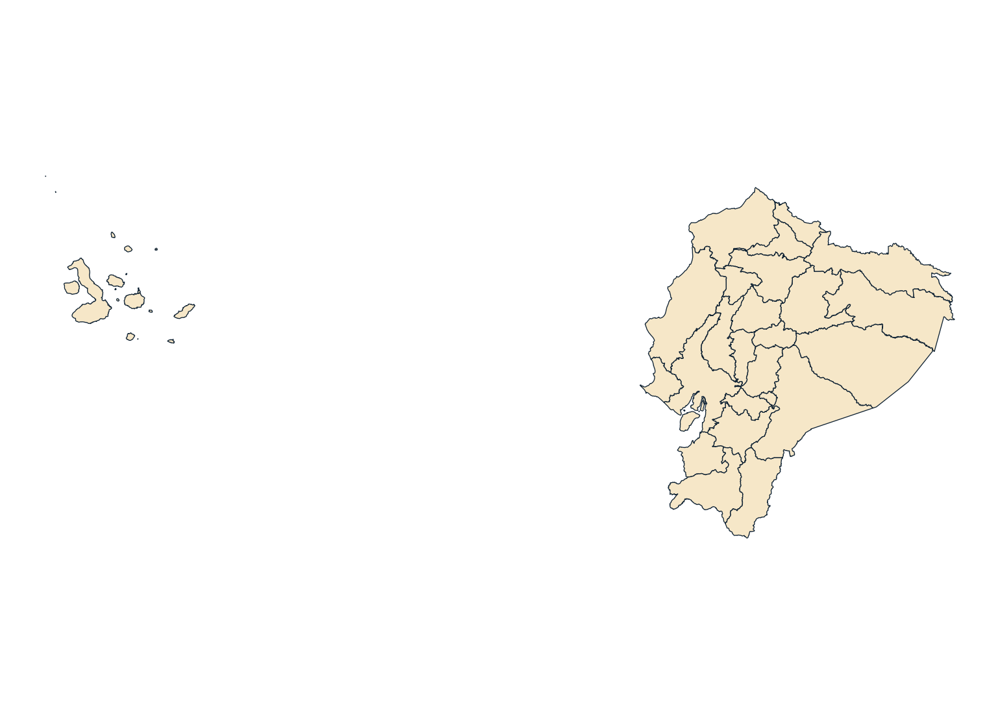
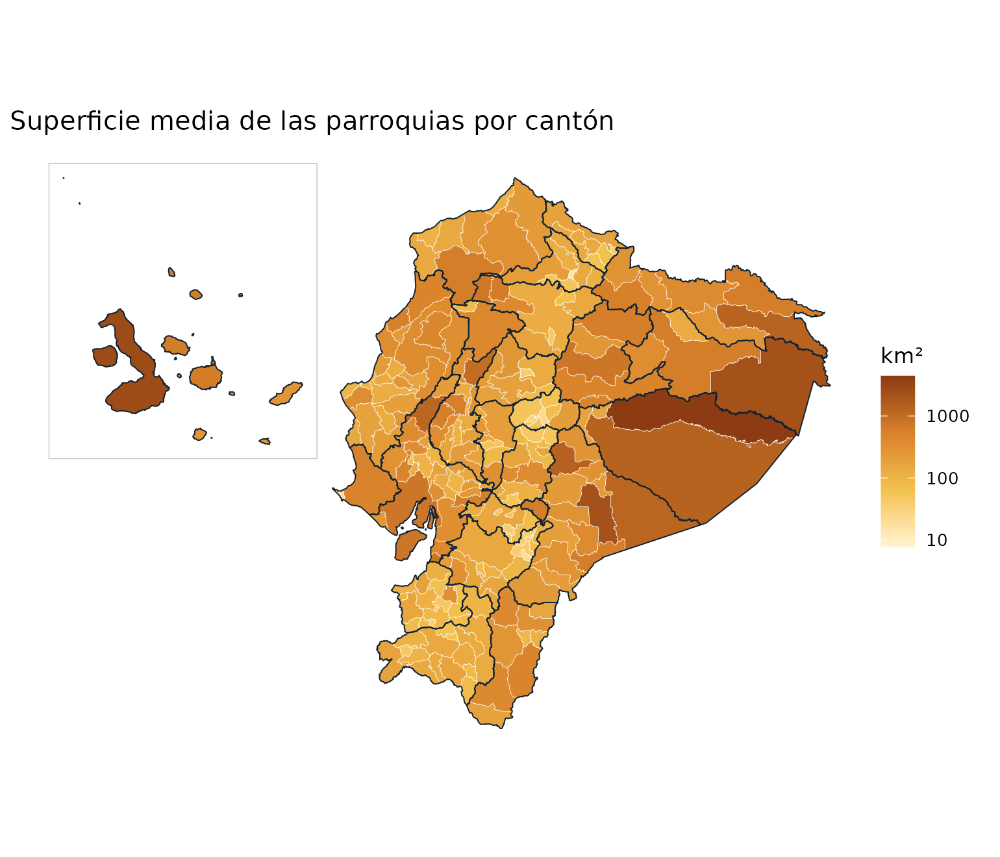
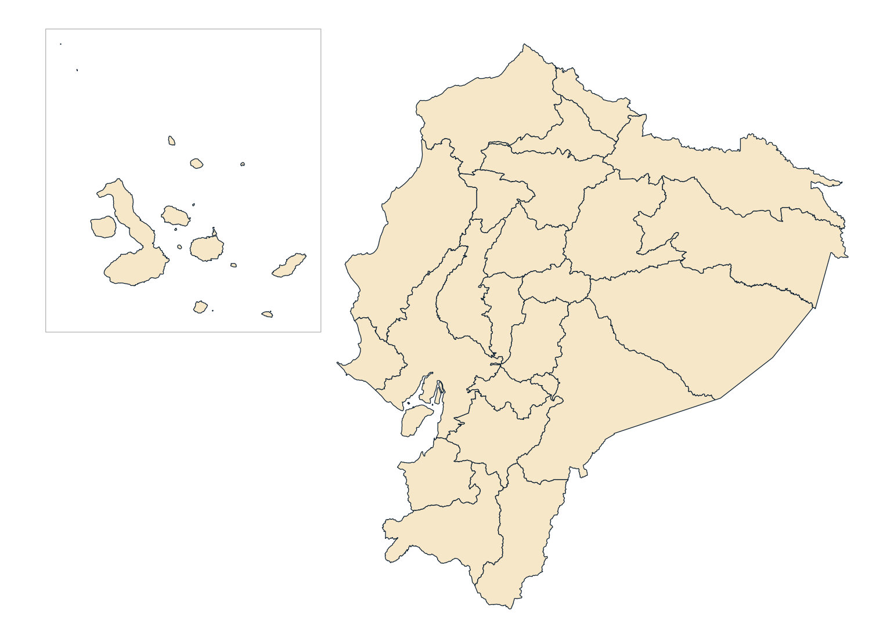

# Guía de uso

Esta guía recorre las funciones de **geoecu** con ejemplos que puedes
copiar y ejecutar. Todos los mapas se generan con los datos del paquete,
sin datos simulados.

``` r

library(geoecu)
library(ggplot2)
```

## 1. Qué ofrece geoecu

geoecu entrega las capas de la División Político-Administrativa (DPA)
del Ecuador como objetos [`sf`](https://r-spatial.github.io/sf/), con
sus códigos oficiales, listas para mapear y para unir con tus tablas:

| Nivel | Función | Unidades |
|----|----|----|
| Provincia | [`read_provincias()`](https://f-slg.github.io/geoecu/reference/read_dpa.md) | 24 provincias y 1 zona en estudio |
| Cantón | [`read_cantones()`](https://f-slg.github.io/geoecu/reference/read_dpa.md) | 223 cantones y 2 zonas en estudio |
| Parroquia | [`read_parroquias()`](https://f-slg.github.io/geoecu/reference/read_dpa.md) | 1048 parroquias (223 cabeceras cantonales y 825 rurales) y 3 zonas en estudio |

Los datos provienen de la **Organización Territorial del Estado** del
Comité Nacional de Límites Internos (CONALI), publicada como datos
abiertos por el Ministerio de Gobierno (licencia CC BY). Los detalles
están en el artículo [Datos: fuente y
procesamiento](https://f-slg.github.io/geoecu/articles/datos.md).

Los tres niveles **encajan exactamente**: cada cantón es la unión de sus
parroquias y cada provincia la unión de sus cantones. Por eso puedes
superponer capas sin huecos ni traslapes.

## 2. Instalación y primera descarga

``` r

install.packages("geoecu")
```

Las geometrías no vienen dentro del paquete. La primera vez que pides
una capa, geoecu descarga un archivo GeoPackage desde GitHub (3 MB en
resolución baja, 39 MB en alta), comprueba que esté completo y lo guarda
en caché. Después funciona sin conexión.

``` r

geoecu_datos_disponibles()   # ¿ya está en caché la resolución baja?
#> [1] TRUE
geoecu_cache_dir()           # dónde se guarda
#> [1] "/home/runner/.cache/R/geoecu/datos-v0.2.0"
```

En Linux, instala antes `sf` desde los repositorios del sistema para
evitar una compilación larga (por ejemplo,
`sudo apt install r-cran-sf`).

## 3. Leer las capas

Cada función devuelve un objeto `sf` en WGS84 (EPSG:4326):

``` r

provincias <- read_provincias()
provincias
#> Simple feature collection with 25 features and 4 fields
#> Geometry type: MULTIPOLYGON
#> Dimension:     XY
#> Bounding box:  xmin: -92.00485 ymin: -5.01518 xmax: -75.18715 ymax: 1.68158
#> Geodetic CRS:  WGS 84
#> First 10 features:
#>    dpa_provin  provincia      tipo  area_km2                       geometry
#> 1          01      AZUAY provincia  8172.708 MULTIPOLYGON (((-79.58575 -...
#> 2          02    BOLÍVAR provincia  3956.929 MULTIPOLYGON (((-78.85256 -...
#> 3          03      CAÑAR provincia  3228.573 MULTIPOLYGON (((-78.77399 -...
#> 4          04     CARCHI provincia  3783.200 MULTIPOLYGON (((-77.76115 0...
#> 5          05   COTOPAXI provincia  6187.707 MULTIPOLYGON (((-78.42733 -...
#> 6          06 CHIMBORAZO provincia  5927.976 MULTIPOLYGON (((-78.44378 -...
#> 7          07     EL ORO provincia  5870.021 MULTIPOLYGON (((-80.00642 -...
#> 8          08 ESMERALDAS provincia 15837.145 MULTIPOLYGON (((-79.74509 0...
#> 9          09     GUAYAS provincia 15899.595 MULTIPOLYGON (((-79.91472 -...
#> 10         10   IMBABURA provincia  4791.589 MULTIPOLYGON (((-78.10539 0...
```

``` r

ggplot(provincias) +
  geom_sf(fill = "#F6E7C8", color = "#0F2233", linewidth = 0.2) +
  theme_void()
```



Las columnas son las mismas en los tres niveles, más los códigos de los
niveles superiores:

| Columna | Contenido |
|----|----|
| `dpa_provin`, `dpa_canton`, `dpa_parroq` | Códigos DPA (texto, con ceros a la izquierda) |
| `provincia`, `canton`, `parroquia` | Nombres oficiales, en mayúsculas |
| `tipo` | `"provincia"`, `"cantón"`, `"cabecera cantonal"`, `"parroquia rural"` o `"zona en estudio"` |
| `area_km2` | Superficie en km², calculada en UTM 17S sobre la resolución alta |

## 4. Filtrar por territorio

Los filtros aceptan **nombres** (sin importar tildes ni mayúsculas) o
**códigos**, como texto o número:

``` r

read_cantones(provincia = "Loja")[, c("dpa_canton", "canton")]
#> Simple feature collection with 16 features and 2 fields
#> Geometry type: MULTIPOLYGON
#> Dimension:     XY
#> Bounding box:  xmin: -80.48635 ymin: -4.7473 xmax: -79.09513 ymax: -3.33017
#> Geodetic CRS:  WGS 84
#> First 10 features:
#>    dpa_canton       canton                       geometry
#> 1        1101         LOJA MULTIPOLYGON (((-79.14861 -...
#> 2        1102       CALVAS MULTIPOLYGON (((-79.60801 -...
#> 3        1103     CATAMAYO MULTIPOLYGON (((-79.26842 -...
#> 4        1104       CELICA MULTIPOLYGON (((-79.96959 -...
#> 5        1105 CHAGUARPAMBA MULTIPOLYGON (((-79.58306 -...
#> 6        1106    ESPÍNDOLA MULTIPOLYGON (((-79.33717 -...
#> 7        1107    GONZANAMÁ MULTIPOLYGON (((-79.40353 -...
#> 8        1108       MACARÁ MULTIPOLYGON (((-80.0349 -4...
#> 9        1109       PALTAS MULTIPOLYGON (((-79.60801 -...
#> 10       1110      PUYANGO MULTIPOLYGON (((-80.12767 -...
nrow(read_parroquias(provincia = 11))        # mismo filtro, por código
#> [1] 94
read_parroquias(canton = "Puyango")$parroquia
#> [1] "ALAMOR"     "CIANO"      "EL ARENAL"  "EL LIMO"    "MERCADILLO"
#> [6] "VICENTINO"
```

Si un nombre de cantón se repite en varias provincias, geoecu te lo dice
y te sugiere cómo resolverlo:

``` r

read_cantones(canton = "Bolivar")
#> Error:
#> ! El nombre 'Bolivar' corresponde a varios/as cantones: 0402 (CARCHI), 1302 (MANABÍ). Usa el código o filtra también por provincia.
read_cantones(provincia = "Manabi", canton = "Bolivar")[, c("dpa_canton", "provincia")]
#> Simple feature collection with 1 feature and 2 fields
#> Geometry type: MULTIPOLYGON
#> Dimension:     XY
#> Bounding box:  xmin: -80.23704 ymin: -1.04355 xmax: -79.87192 ymax: -0.79915
#> Geodetic CRS:  WGS 84
#>   dpa_canton provincia                       geometry
#> 1       1302    MANABÍ MULTIPOLYGON (((-80.00637 -...
```

Y si escribes un nombre que no existe, propone los más parecidos:

``` r

read_provincias("Lojja")
#> Error:
#> ! No se encontró la provincia 'Lojja'. ¿Quisiste decir: LOJA?
```

### Cabeceras, parroquias rurales y zonas en estudio

El argumento `tipo` de
[`read_parroquias()`](https://f-slg.github.io/geoecu/reference/read_dpa.md)
filtra por tipo de parroquia:

``` r

table(read_parroquias()$tipo)
#> 
#> cabecera cantonal   parroquia rural   zona en estudio 
#>               223               825                 3
read_parroquias(canton = "Puyango", tipo = "rural")$parroquia
#> [1] "CIANO"      "EL ARENAL"  "EL LIMO"    "MERCADILLO" "VICENTINO"
```

Las **parroquias urbanas** no aparecen como polígonos propios: forman
parte de su **cabecera cantonal**, tal como las delimita el CONALI.

Las **zonas en estudio** son territorios cuyos límites aún no están
resueltos. Se incluyen para que el mapa nacional no tenga huecos:

``` r

read_parroquias(tipo = "zona")[, c("dpa_parroq", "parroquia", "area_km2")]
#> Simple feature collection with 3 features and 3 fields
#> Geometry type: MULTIPOLYGON
#> Dimension:     XY
#> Bounding box:  xmin: -80.69712 ymin: -2.6269 xmax: -77.93053 ymax: -0.93145
#> Geodetic CRS:  WGS 84
#>   dpa_parroq                                 parroquia area_km2
#> 1     139090          ZONA EN ESTUDIO "JARAMIJO-MANTA"    7.699
#> 2     140190        ZONA EN ESTUDIO "SINAÍ-CUCHAENTZA"   19.559
#> 3     900651 ZONA EN ESTUDIO: JUVAL (CAÑAR-CHIMBORAZO)  606.224
#>                         geometry
#> 1 MULTIPOLYGON (((-80.67187 -...
#> 2 MULTIPOLYGON (((-78.03429 -...
#> 3 MULTIPOLYGON (((-78.53311 -...
```

Para excluirlas de un análisis:

``` r

cantones <- read_cantones()
cantones <- cantones[cantones$tipo != "zona en estudio", ]
nrow(cantones)
#> [1] 223
```

## 5. Resolución y sistema de coordenadas

Hay dos resoluciones:

- `"baja"` (por defecto): simplificación de 250 m. Liviana, ideal para
  mapas, boletines y tableros Shiny.
- `"alta"`: simplificación de 10 m. Para análisis espacial
  (intersecciones, distancias, conteo de puntos en polígonos).

``` r

loja_baja <- read_cantones(provincia = "Loja")
loja_alta <- read_cantones(provincia = "Loja", resolucion = "alta")
c(baja = object.size(loja_baja), alta = object.size(loja_alta))
#>   baja   alta 
#>  59400 774824
```

Para medir **áreas o distancias en metros**, usa un sistema proyectado
como UTM 17S (`crs = 32717`):

``` r

loja <- read_cantones(provincia = "Loja", crs = 32717)
sf::st_crs(loja)$epsg
#> [1] 32717
head(loja[, c("canton", "area_km2")])
#> Simple feature collection with 6 features and 2 fields
#> Geometry type: MULTIPOLYGON
#> Dimension:     XY
#> Bounding box:  xmin: 584243.1 ymin: 9475071 xmax: 710810.6 ymax: 9594129
#> Projected CRS: WGS 84 / UTM zone 17S
#>         canton area_km2                       geometry
#> 1         LOJA 1891.245 MULTIPOLYGON (((705567.1 95...
#> 2       CALVAS  851.003 MULTIPOLYGON (((654500.3 95...
#> 3     CATAMAYO  651.847 MULTIPOLYGON (((692247.1 95...
#> 4       CELICA  521.597 MULTIPOLYGON (((614379.5 95...
#> 5 CHAGUARPAMBA  313.231 MULTIPOLYGON (((657334.9 95...
#> 6    ESPÍNDOLA  516.249 MULTIPOLYGON (((684478.4 94...
```

## 6. Unir tus datos

[`geoecu_unir()`](https://f-slg.github.io/geoecu/reference/geoecu_unir.md)
une una tabla con la capa del nivel indicado usando el código DPA.
Conserva todos los polígonos de la capa, así que los territorios sin
datos quedan con `NA` y aparecen en el mapa.

Los códigos que vienen de Excel suelen perder los ceros a la izquierda
(`701` en lugar de `"0701"`); geoecu los corrige automáticamente:

``` r

mis_datos <- data.frame(
  cod_canton = c(1101, 1102, 1110, 701),   # 0701 = Machala, guardado como número
  valor = c(10, 4, 7, 20)
)
mapa <- geoecu_unir(mis_datos, codigo = "cod_canton", nivel = "canton",
                    provincia = c("Loja", "El Oro"))
mapa[!is.na(mapa$valor), c("dpa_canton", "canton", "valor")]
#> Simple feature collection with 4 features and 3 fields
#> Geometry type: MULTIPOLYGON
#> Dimension:     XY
#> Bounding box:  xmin: -80.29568 ymin: -4.52616 xmax: -79.10075 ymax: -3.17095
#> Geodetic CRS:  WGS 84
#>    dpa_canton  canton valor                       geometry
#> 1        0701 MACHALA    20 MULTIPOLYGON (((-79.92783 -...
#> 15       1101    LOJA    10 MULTIPOLYGON (((-79.14861 -...
#> 16       1102  CALVAS     4 MULTIPOLYGON (((-79.60801 -...
#> 24       1110 PUYANGO     7 MULTIPOLYGON (((-80.12767 -...
```

geoecu avisa cuando algo no cuadra:

``` r

# Código que no existe en la capa
x <- geoecu_unir(data.frame(cod = c(1101, 9999), n = 1:2), "cod", "canton",
                 provincia = "Loja")
#> Warning: 1 código(s) de `datos` no están en la capa: 9999
```

``` r

# Códigos repetidos: agrega tus datos antes de unir
x <- geoecu_unir(data.frame(cod = c(1101, 1101), n = 1:2), "cod", "canton",
                 provincia = "Loja")
#> Warning: Hay códigos repetidos en `datos`: la unión duplicará polígonos. Agrega
#> tus datos por código antes de unir.
```

### Limpiar códigos y nombres

Si tu tabla tiene nombres en lugar de códigos, o códigos mal
formateados, estas funciones ayudan antes de unir:

``` r

formatear_codigo(c(1, 11, "7"), "provincia")
#> [1] "01" "11" "07"
formatear_codigo(c(701, 1101), "canton")
#> [1] "0701" "1101"
normalizar_nombre(c("Cañar", "  san  José de Chimbo", "CHECA (JIDCAY)"))
#> [1] "CANAR"              "SAN JOSE DE CHIMBO" "CHECA JIDCAY"
buscar_dpa("arenal")
#>   dpa_parroq parroquia            tipo dpa_canton  canton dpa_provin provincia
#> 1     111052 EL ARENAL parroquia rural       1110 PUYANGO         11      LOJA
buscar_dpa("santa elena", nivel = "provincia")
#>   dpa_provin   provincia
#> 1         24 SANTA ELENA
```

## 7. Mapas temáticos

Un ejemplo completo con datos reales del catálogo: la superficie media
de las parroquias de cada cantón.

``` r

parr <- read_parroquias()
sup <- aggregate(area_km2 ~ dpa_canton, data = sf::st_drop_geometry(parr),
                 FUN = mean)
names(sup)[2] <- "km2_por_parroquia"

mapa <- geoecu_unir(sup, "dpa_canton", "canton", crs = 32717) |>
  reubicar_galapagos()
prov <- reubicar_galapagos(read_provincias(crs = 32717))

ggplot() +
  geom_sf(data = mapa, aes(fill = km2_por_parroquia), color = "white",
          linewidth = 0.1) +
  geom_sf(data = prov, fill = NA, color = "#0F2233", linewidth = 0.3) +
  geom_sf(data = marco_galapagos(prov), fill = NA, color = "grey75") +
  scale_fill_gradientn(colours = c("#FFF4D2", "#F2C14E", "#D9822B", "#8C3B12"),
                       trans = "log10", name = "km²") +
  labs(title = "Superficie media de las parroquias por cantón") +
  theme_void() +
  theme(plot.margin = margin(5, 15, 5, 5))
```



Consejos:

- Usa `linewidth` pequeño (0.05 a 0.2) en el nivel parroquial: son más
  de mil polígonos.
- Para clasificar en intervalos (cuantiles, cortes fijos), crea la
  variable con [`cut()`](https://rdrr.io/r/base/cut.html) antes de
  mapear y usa
  [`scale_fill_manual()`](https://ggplot2.tidyverse.org/reference/scale_manual.html)
  o
  [`scale_fill_brewer()`](https://ggplot2.tidyverse.org/reference/scale_brewer.html).
- Para tableros interactivos, la resolución baja carga rápido en
  [leaflet](https://rstudio.github.io/leaflet/) o
  [mapview](https://r-spatial.github.io/mapview/), con `crs = 4326`.

## 8. Galápagos en mapas nacionales

En un mapa nacional, Galápagos queda lejos del continente y desperdicia
espacio.
[`reubicar_galapagos()`](https://f-slg.github.io/geoecu/reference/reubicar_galapagos.md)
lo traslada a la esquina superior izquierda y
[`marco_galapagos()`](https://f-slg.github.io/geoecu/reference/marco_galapagos.md)
devuelve un recuadro para dibujarlo:

``` r

prov <- reubicar_galapagos(read_provincias(crs = 32717))
ggplot(prov) +
  geom_sf(fill = "#F6E7C8", color = "#0F2233", linewidth = 0.2) +
  geom_sf(data = marco_galapagos(prov), fill = NA, color = "grey70") +
  theme_void()
```



Funciona con los tres niveles y con capas unidas con
[`geoecu_unir()`](https://f-slg.github.io/geoecu/reference/geoecu_unir.md).
Si reubicas varias capas para superponerlas, todas quedan alineadas. El
traslado es **solo para visualizar**: para medir áreas o distancias usa
las capas sin reubicar.

## 9. Agregar sin geometrías

El catálogo `dpa` tiene una fila por parroquia con los códigos y nombres
de los tres niveles. Sirve para agregar datos parroquiales a cantón o
provincia sin leer geometrías:

``` r

head(dpa)
#>   dpa_parroq  parroquia              tipo dpa_canton canton dpa_provin
#> 1     010150     CUENCA cabecera cantonal       0101 CUENCA         01
#> 2     010151      BAÑOS   parroquia rural       0101 CUENCA         01
#> 3     010152      CUMBE   parroquia rural       0101 CUENCA         01
#> 4     010153    CHAUCHA   parroquia rural       0101 CUENCA         01
#> 5     010154      CHECA   parroquia rural       0101 CUENCA         01
#> 6     010155 CHIQUINTAD   parroquia rural       0101 CUENCA         01
#>   provincia
#> 1     AZUAY
#> 2     AZUAY
#> 3     AZUAY
#> 4     AZUAY
#> 5     AZUAY
#> 6     AZUAY

# Parroquias rurales por provincia
rurales <- dpa[dpa$tipo == "parroquia rural", ]
head(sort(table(rurales$provincia), decreasing = TRUE))
#> 
#>       LOJA      AZUAY ESMERALDAS     MANABÍ  PICHINCHA     EL ORO 
#>         78         61         56         56         54         50
```

``` r

# Agregar una tabla parroquial a cantón
casos <- data.frame(dpa_parroq = c("110150", "110151", "110152", "110250"),
                    casos = c(5, 2, 1, 3))
casos <- merge(casos, dpa[c("dpa_parroq", "dpa_canton", "canton")])
aggregate(casos ~ dpa_canton + canton, data = casos, FUN = sum)
#>   dpa_canton canton casos
#> 1       1102 CALVAS     3
#> 2       1101   LOJA     8
```

## 10. Tablas con códigos de versiones anteriores

geoecu 0.3.0 y anteriores usaban otra capa de origen, con parroquias
urbanas y sin los cantones nuevos. Si tus tablas usan esos códigos,
[`actualizar_codigo()`](https://f-slg.github.io/geoecu/reference/actualizar_codigo.md)
los convierte al código actual:

``` r

actualizar_codigo(c("010101", "010102", "080253", "110152"))
#> [1] "010150" "010150" "080950" "110152"
```

- `"010101"` y `"010102"` (parroquias urbanas de Cuenca) pasan a la
  cabecera cantonal `"010150"`.
- `"080253"` (Borbón, antes en Eloy Alfaro) pasa a `"080950"`, cabecera
  del nuevo cantón Borbón.
- Los códigos vigentes no cambian.

Después de convertir, **agrega** tus datos por el código nuevo, porque
varias parroquias anteriores pueden convertirse en la misma:

``` r

antigua <- data.frame(cod = c("010101", "010102", "010150"), casos = c(3, 4, 1))
antigua$cod <- actualizar_codigo(antigua$cod)
aggregate(casos ~ cod, data = antigua, FUN = sum)
#>      cod casos
#> 1 010150     8
```

La tabla `dpa_equivalencias` muestra la correspondencia completa,
incluida la proporción del área anterior que cae en cada parroquia
actual:

``` r

subset(dpa_equivalencias, principal & cambio == "código distinto",
       c(dpa_parroq_anterior, parroquia_anterior, dpa_parroq, parroquia, proporcion))
#>      dpa_parroq_anterior                        parroquia_anterior dpa_parroq
#> 124               030157                                    RIVERA     900651
#> 357               071203              BALNEARIO JAMBELI (SATELITE)     071252
#> 399               080251                                 ANCHAYACU     080951
#> 400               080252             ATAHUALPA (CAB. EN CAMARONES)     080952
#> 401               080253                                    BORBON     080950
#> 403               080255 LUIS VARGAS TORRES (CAB. EN PLAYA DE ORO)     080953
#> 404               080256                                 MALDONADO     080954
#> 406               080258                   SAN FRANCISCO DE ONZOLE     080955
#> 407               080259                   SANTO DOMINGO DE ONZOLE     080956
#> 408               080260                              SELVA ALEGRE     080957
#> 409               080261                                   TELEMBI     080958
#> 410               080262                      COLON ELOY DEL MARIA     080959
#> 411               080263                       SAN JOSE DE CAYAPAS     080960
#> 412               080264                                   TIMBIRE     080961
#> 860               140157                         SEVILLA DON BOSCO     141350
#> 951               160162       SIMON BOLIVAR (CAB. EN MUSHULLACTA)     160167
#> 1035              170203                             JUAN MONTALVO     170257
#> 1036              170250                                   CAYAMBE     170257
#> 1180              200353                               BELLA VISTA     200351
#> 1240              220254                                  TIPUTINI     220250
#>                                      parroquia proporcion
#> 124  ZONA EN ESTUDIO: JUVAL (CAÑAR-CHIMBORAZO)      0.591
#> 357                                    JAMBELÍ      0.999
#> 399                                  ANCHAYACU      1.000
#> 400                                  ATAHUALPA      1.000
#> 401                                     BORBÓN      0.999
#> 403                         LUIS VARGAS TORRES      0.999
#> 404                                  MALDONADO      1.000
#> 406                    SAN FRANCISCO DE ONZOLE      1.000
#> 407                    SANTO DOMINGO DE ONZOLE      1.000
#> 408                               SELVA ALEGRE      1.000
#> 409                                    TELEMBÍ      1.000
#> 410                       COLÓN ELOY DEL MARÍA      1.000
#> 411                        SAN JOSÉ DE CAYAPAS      1.000
#> 412                                    TIMBIRÉ      1.000
#> 860                          SEVILLA DON BOSCO      0.991
#> 951                              SHUAR PASTAZA      0.724
#> 1035                             JUAN MONTALVO      0.997
#> 1036                             JUAN MONTALVO      0.864
#> 1180                               BELLA VISTA      0.998
#> 1240                          NUEVO ROCAFUERTE      0.820
```

## 11. Trabajar sin conexión o en servidores

Una vez descargados, los datos se leen de la caché. Para entornos sin
internet (servidores institucionales, Shiny Server, equipos de campo),
descarga los archivos `geoecu_dpa_baja.gpkg` y `geoecu_dpa_alta.gpkg`
desde el [release de
datos](https://github.com/f-slg/geoecu/releases/tag/datos-v0.2.0),
cópialos a una carpeta e indícala:

``` r

geoecu_usar_carpeta("/srv/datos/geoecu")
```

O de forma permanente, en tu archivo `.Renviron`:

    GEOECU_CARPETA=/srv/datos/geoecu

Para borrar la caché y forzar una descarga nueva:
[`geoecu_limpiar_cache()`](https://f-slg.github.io/geoecu/reference/geoecu_limpiar_cache.md).

## 12. Cómo citar

``` r

citation("geoecu")
```

Al publicar mapas o análisis con estas capas, cita también la fuente de
los datos, como pide el CONALI:

> Comité Nacional de Límites Internos (CONALI), Ministerio de Gobierno
> del Ecuador. Límites territoriales de la Organización Territorial del
> Estado interparroquiales, aprobados por el Directorio del CONALI en
> sesión ordinaria del 24 de marzo de 2022, 17 de enero de 2023 y 13 de
> marzo de 2026. Datos abiertos, licencia CC BY.
